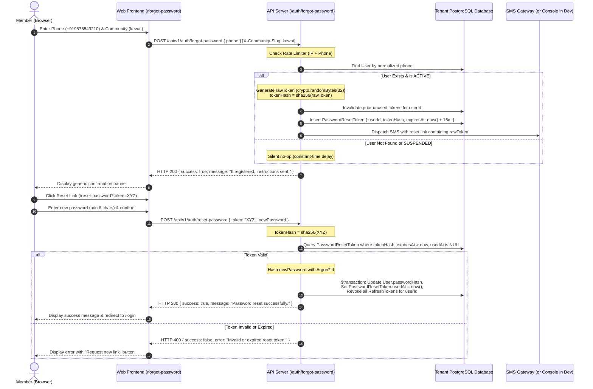

# Apna Samaj — Batch 15A.1: Authentication & Password Reset Pre-Implementation Audit

**Date:** 2026-10-30T13:45:00 IST  
**Repository:** `https://github.com/ravindrakewat/ApnaSamaj.git`  
**Current Branch:** `main` (commit `f7ac1b5`)  
**Scope:** Read-Only Authentication Architecture Audit, Recovery Channel Analysis, Database Schema Evaluation, Tenant Isolation Inspection, and Password Reset Implementation Specification.

---

## 1. Executive Summary & Verdict

- **Audit Verdict:** **GO for Architecture, Core API & Web UI Implementation; CONDITIONAL on SMS Provider Configuration for Live Production Delivery.**
- **Database Schema Readiness:** The `PasswordResetToken` table was already created in the initial migration (`20261015135430_init_phase1_auth_feed_groups`) and exists in all tenant databases. **Zero database migrations or schema alterations are required.**
- **Recovery Channel Finding:** The application identifies members solely by mobile number (`+91[6-9]\d{9}`). Neither `User` nor `Profile` possesses an `email` field, and **no SMS gateway or OTP provider is configured in the codebase or environment**.
- **Security Rule:** Account ownership cannot be established merely by knowing a phone number. In production, a real SMS provider (or WhatsApp Business gateway) is strictly required to deliver the one-time token/link. In non-production environments (`NODE_ENV !== 'production'`), a secure development adapter (console logger) enables thorough testing without creating insecure production bypasses.

---

## 2. Existing Authentication Architecture

### 2.1 Identity & Credential Modeling
- **Single Identifier:** Indian mobile numbers in E.164 format (`+91XXXXXXXXXX`), validated via `phoneSchema` and `normalizeIndianPhone` in `@apnasamaj/validation`.
- **Password Hashing:** Argon2id via `argon2` npm package with strong security parameters:
  - Algorithm: Argon2id (`argon2.argon2id`)
  - Memory cost: 64 MB (`2 ** 16`)
  - Time cost: 3 iterations
  - Parallelism: 1 thread
  - Password verification: `verifyPassword(hash, plainText)` in `apps/api/src/modules/auth/auth.password.ts`.
- **Absence of Email:** No `email` column exists on the `User` or `Profile` models in `schema.prisma`.

### 2.2 Token Architecture & Session Management
- **Stateless Access Tokens (JWT):**
  - Signed with HMAC-SHA256 using `JWT_ACCESS_SECRET` (minimum 32 characters).
  - Short-lived lifetime (default: 15 minutes, configured via `JWT_ACCESS_EXPIRES_IN`).
  - Minimal claims: `sub` (userId), `phone`, `role`, `status`, `communitySlug`, `jti`, `iat`, `exp`.
  - Frontend storage: Kept strictly in-memory (`inMemoryAccessToken` in `apps/web/src/services/api.client.ts`).
- **Opaque Refresh Tokens & Family Rotation:**
  - High-entropy cryptographic random string generated via `crypto.randomBytes(40).toString('hex')` (320 bits of entropy).
  - Stored at rest as a SHA-256 hash (`tokenHash`). Raw refresh tokens are never persisted.
  - Linked to a `familyId` (UUID) to track session lineages.
  - Automatic replay attack detection: If an already-rotated or revoked token is reused, all sessions in that family are immediately revoked with HTTP 401 (`ReplayAttackError`).
  - Transport: Secure, HttpOnly cookie named `refreshToken`, scoped to `/api/v1/auth`, with `SameSite: 'none'` (production) or `'lax'` (development).

### 2.3 Authentication Middleware
- `authenticateToken` in `apps/api/src/middleware/authenticate.ts`:
  1. Validates Bearer JWT signature and expiration.
  2. Enforces cross-tenant token boundaries: If the token contains a `communitySlug` that contradicts `req.tenant.slug`, access is rejected with HTTP 403 Forbidden.
  3. Reloads real-time user status and role directly from the active tenant database so deactivated or suspended users are immediately blocked.

### 2.4 Multi-Tenant Boundary Enforcement
- Tenant resolution is handled by `resolveTenantContext` in `tenant.middleware.ts`.
- Evaluates `Origin`, `Host`, `Referer`, and `X-Community-Slug`.
- Rejects conflicting requests with HTTP 400 Bad Request.
- Resolves independent Prisma database clients via `TenantDatabaseManager` (`packages/database/src/tenant-manager.ts`).
- Unknown community tenants fail closed with HTTP 404 (zero Kewat fallback for unknown communities).

### 2.5 Existing Rate Limiting
- Configured using `express-rate-limit` in `apps/api/src/middleware/rate-limiter.ts`:
  - `loginRateLimiter`: 10 requests per 15 minutes per IP.
  - `registerRateLimiter`: 10 requests per 15 minutes per IP.
  - `refreshRateLimiter`: 30 requests per 15 minutes per IP.

---

## 3. Relevant File Paths

| Layer | File Path | Current Role / Relevance |
| :--- | :--- | :--- |
| **Prisma Schema** | `packages/database/prisma/schema.prisma` | Defines `User` (lines 144-176) and `PasswordResetToken` (lines 215-225). |
| **Migrations** | `packages/database/prisma/migrations/20261015135430_init_phase1_auth_feed_groups/migration.sql` | Contains DDL for `PasswordResetToken` table and indexes. |
| **Tenant Manager** | `packages/database/src/tenant-manager.ts` | Multi-tenant Prisma client caching and isolation. |
| **Auth Routes** | `apps/api/src/modules/auth/auth.routes.ts` | Maps `/register`, `/login`, `/refresh`, `/logout`, `/me`. |
| **Auth Controller** | `apps/api/src/modules/auth/auth.controller.ts` | Request handlers, validation parsing, cookie handling. |
| **Auth Service** | `apps/api/src/modules/auth/auth.service.ts` | Core business logic for authentication and token families. |
| **Auth Tokens** | `apps/api/src/modules/auth/auth.tokens.ts` | JWT signing, `hashToken` (SHA-256), cookie helpers. |
| **Auth Password** | `apps/api/src/modules/auth/auth.password.ts` | Argon2id verification helper. |
| **Rate Limiters** | `apps/api/src/middleware/rate-limiter.ts` | IP-based request rate limiting. |
| **Tenant Middleware**| `apps/api/src/middleware/tenant.middleware.ts` | Domain/Header resolution and fail-closed tenant boundary guards. |
| **Config / Env** | `apps/api/src/config/env.ts` | Validates environment variables (JWT secrets, URLs, ports). |
| **Validation** | `packages/validation/src/auth.ts` | Zod schemas for login, register, profile, and refresh. |
| **Validation Phone**| `packages/validation/src/phone.ts` | E.164 phone normalization, regex validation, phone masking. |
| **Web Router** | `apps/web/src/App.tsx` | Client-side routing and lazy-loaded page components. |
| **Web Login Page** | `apps/web/src/pages/LoginPage.tsx` | Member login UI with community selector and credentials form. |
| **Web API Client** | `apps/web/src/services/api.client.ts` | Fetch wrapper with automatic tenant header injection and token refresh. |
| **Web Auth Service**| `apps/web/src/services/auth.service.ts` | Frontend API client functions for auth endpoints. |
| **Auth Context** | `apps/web/src/context/AuthContext.tsx` | React state context for authenticated user and session management. |

---

## 4. Existing Reusable Components & Models

1. **`PasswordResetToken` Model (Already Migrated):**
   ```prisma
   model PasswordResetToken {
     id        String    @id @default(uuid())
     userId    String
     user      User      @relation(fields: [userId], references: [id], onDelete: Cascade)
     tokenHash String    @unique // SHA-256 hash of the one-time reset token
     expiresAt DateTime  // Fixed 1-hour expiration
     usedAt    DateTime?
     createdAt DateTime  @default(now())

     @@index([userId])
   }
   ```
2. **Cryptographic Token Helpers:**
   - `hashToken(rawToken: string)` in `auth.tokens.ts`: Returns `crypto.createHash('sha256').update(rawToken.trim()).digest('hex')`.
   - `crypto.randomBytes(32).toString('hex')` for 256-bit cryptographically secure one-time tokens.
3. **Argon2id Password Hashing:**
   - Standardized hashing in `auth.service.ts` (lines 195-200) ensuring consistent hashing for newly reset passwords.
4. **Validation Schemas:**
   - `phoneSchema` in `@apnasamaj/validation` for phone input normalization and format verification.
   - Password minimum length (8 characters) standard.
5. **Frontend UI Patterns:**
   - Material-UI login layout (`Container maxWidth="xs"`, `Paper elevation={3}`, `LockOutlinedIcon`).
   - Community lock badge / dropdown selector from `LoginPage.tsx`.
   - Masked phone display helper `maskPhone(+91XXXXXXXXXX)`.

---

## 5. Recovery-Channel Availability & Findings

### 5.1 Recovery Channel Audit
- **Email Channel:** **UNAVAILABLE**. Neither `User` nor `Profile` stores email addresses. No SMTP, SendGrid, SES, or Resend provider is configured.
- **SMS Gateway / OTP Channel:** **UNAVAILABLE**. No SMS service (Fast2SMS, MSG91, Twilio, Textlocal) is configured in dependencies, code, or `.env`.
- **In-App Notifications:** **UNSUITABLE FOR RECOVERY**. Notifications can only be retrieved by an already-authenticated user. A locked-out user cannot view internal notifications.
- **`isPhoneVerified` Flag Status:** All new member registrations set `isPhoneVerified: false`. It is only set to `true` during seed execution or manual administrative action.

### 5.2 Security Principle on Account Ownership
> [!IMPORTANT]
> A phone number alone is **publicly knowable information** and **does NOT prove account ownership**.
> Allowing an anonymous requester to reset a password without verifying possession of the handset would create an immediate, critical account takeover vulnerability across the entire platform.

### 5.3 Required Production Provider Configuration
For live production delivery of password recovery, Apna Samaj requires an Indian DLT-compliant SMS provider:
- **Recommended Provider:** **MSG91** or **Fast2SMS** (supports TRAI DLT registration required in India).
- **Alternative Provider:** **Twilio Verify API** (handles OTP generation and global delivery).
- **Required Configuration Variables:**
  ```dotenv
  SMS_PROVIDER="fast2sms" # or "msg91", "twilio", "console"
  SMS_API_KEY="your-sms-gateway-api-key"
  SMS_SENDER_ID="APNASM" # Registered 6-character DLT Header
  SMS_DLT_TEMPLATE_ID="120716xxxxxxxxxx" # Approved DLT SMS Template
  ```

---

## 6. Security Gaps & Protections

| Threat / Risk | Vulnerability Description | Mitigation Strategy |
| :--- | :--- | :--- |
| **Account Takeover** | Attacker resets victim's password by submitting their phone number. | Must require proof of possession via out-of-band one-time token/link delivered via SMS. |
| **Phone Enumeration** | Attacker probes phone numbers to determine which users exist in the community. | Endpoint returns identical generic success message regardless of whether the phone exists or is active. |
| **SMS Toll Fraud & Flooding** | Attacker repeatedly requests reset codes to deplete SMS balance or harass members. | Dual-tier rate limiting: IP rate limiter (3 req/15 min) + Phone rate limiter (1 req/2 min). |
| **Token Brute-Force** | Attacker attempts to guess numeric OTPs. | Use 32-byte (256-bit entropy) high-entropy alphanumeric tokens (`crypto.randomBytes(32)`). A 256-bit token is immune to brute force. |
| **Database Token Leakage** | Database compromise reveals reset tokens. | Tokens are hashed with SHA-256 at rest; raw token is only sent out-of-band and never saved in database. |
| **Stale Token Hoarding** | User requests multiple reset links; older links remain valid. | Generating a new reset token atomically invalidates all previous unused tokens for that user. |
| **Active Session Hijacking** | Thief maintains active session after legitimate owner resets password. | Successful password reset atomically revokes all existing refresh tokens (`isRevoked: true`) across all families for that user. |
| **Tenant Tampering** | Attacker uses reset token from Kewat Samaj on Gupta Samaj. | Reset token is stored in the specific tenant's database; reset execution requires the matching tenant context. |

---

## 7. Recommended Implementation Approach

### 7.1 Architecture: Delivery Adapter Pattern
To avoid "fake working OTPs" while enabling full testability in development and staging, implement a pluggable `DeliveryService` interface:

```typescript
export interface ResetDeliveryResult {
  success: boolean;
  channel: 'sms' | 'console' | 'none';
  error?: string;
}

export interface IResetDeliveryService {
  deliverResetLink(phone: string, rawToken: string, tenantSlug: string): Promise<ResetDeliveryResult>;
}
```

- **Production Mode (`NODE_ENV === 'production'`):**
  - Uses `SmsDeliveryService`.
  - If SMS credentials are missing, logs a server error (`[Auth] SMS provider unconfigured; token generated but cannot be dispatched`) and returns a generic client response. **Never bypasses verification in production.**
- **Development / Staging Mode (`NODE_ENV !== 'production'`):**
  - Uses `ConsoleDeliveryService`.
  - Logs the reset link (`http://localhost:5173/reset-password?token=<RAW_TOKEN>`) directly to the server terminal for developers and QA engineers to test the complete end-to-end flow.

### 7.2 Token Lifecycle & Workflow



---

## 8. Proposed API Endpoints and Frontend Routes

### 8.1 API Endpoints (`apps/api/src/modules/auth/auth.routes.ts`)

1. **`POST /api/v1/auth/forgot-password`**
   - **Protection:** Anonymous, `forgotPasswordRateLimiter` (3 requests / 15 min per IP; 1 request / 2 min per phone).
   - **Headers:** `X-Community-Slug` or community subdomain origin.
   - **Input Validation (Zod):**
     ```typescript
     export const forgotPasswordSchema = z.object({
       phone: phoneSchema,
     });
     ```
   - **Behavior:**
     - Checks resolved tenant database.
     - Looks up user. If active, generates 32-byte token, hashes with SHA-256, sets 15-minute expiration, invalidates older tokens, and dispatches link.
     - **Response:** Always returns HTTP 200 with generic success message to prevent user enumeration.

2. **`POST /api/v1/auth/verify-reset-token`** (Preflight token check)
   - **Protection:** Anonymous.
   - **Input Validation (Zod):**
     ```typescript
     export const verifyResetTokenSchema = z.object({
       token: z.string().min(32, 'Invalid reset token format'),
     });
     ```
   - **Behavior:**
     - Hashes token and checks whether an unexpired, unused token exists in the tenant DB.
   - **Response:** HTTP 200 `{ success: true, valid: true }` or HTTP 400 `{ success: false, error: 'Invalid or expired token.' }`.

3. **`POST /api/v1/auth/reset-password`**
   - **Protection:** Anonymous, `resetPasswordRateLimiter`.
   - **Input Validation (Zod):**
     ```typescript
     export const resetPasswordSchema = z.object({
       token: z.string().min(32, 'Invalid reset token format'),
       newPassword: z.string().min(8, 'Password must be at least 8 characters long'),
     });
     ```
   - **Behavior:**
     - Atomically marks token as used (`usedAt = new Date()`).
     - Hashes new password with Argon2id.
     - Updates `User.passwordHash`.
     - Invalidates all existing refresh tokens for the user (`isRevoked: true, revokedAt: new Date()`).
   - **Response:** HTTP 200 `{ success: true, message: 'Password has been reset successfully. Please log in.' }`.

### 8.2 Frontend Routes & Views (`apps/web/src/`)

1. **Route `/forgot-password` (`ForgotPasswordPage.tsx`):**
   - Community context selection (or domain lock chip, matching `LoginPage.tsx`).
   - Phone input with `+91` adornment and validation.
   - Submitting triggers `forgotPasswordApi(phone, communitySlug)`.
   - Success state shows confirmation banner with back-to-login button.
2. **Route `/reset-password` (`ResetPasswordPage.tsx`):**
   - Extracts `?token=...` from URL query parameter.
   - Verifies token validity on mount via `verifyResetTokenApi`.
   - Displays new password and confirm password fields with show/hide toggles.
   - Submitting triggers `resetPasswordApi(token, newPassword, communitySlug)`.
   - Success state redirects to `/login` with success banner.
   - Expired token state displays an alert and a button to return to `/forgot-password`.
3. **Update `LoginPage.tsx`:**
   - Add a "Forgot Password?" router link placed directly below the password input.

---

## 9. Proposed Database Changes

### Verdict: **NO DATABASE CHANGES NEEDED**

The Prisma schema already contains:
```prisma
model PasswordResetToken {
  id        String    @id @default(uuid())
  userId    String
  user      User      @relation(fields: [userId], references: [id], onDelete: Cascade)
  tokenHash String    @unique
  expiresAt DateTime
  usedAt    DateTime?
  createdAt DateTime  @default(now())

  @@index([userId])
}
```

- **Hashed at rest:** `tokenHash` stores `sha256(rawToken)`.
- **Single-use:** `usedAt` timestamp tracks redemption.
- **Expiry:** `expiresAt` supports custom 15-minute lifetimes.
- **Cascade Deletion:** `userId` cascades if user account is deleted.
- **Tenant Scoped:** Table resides physically inside each community's PostgreSQL database.

Zero migration files and zero database DDL commands are required.

---

## 10. Detailed Test Plan

An automated test suite (`apps/api/src/tests/auth-password-reset.test.ts`) and web UX suite (`apps/web/src/tests/password-reset-experience.test.ts`) should be implemented covering 14 discrete verification cases:

| Test ID | Test Scenario | Expected Outcome |
| :---: | :--- | :--- |
| **TC-PR-01** | Forgot password with registered active phone number | Returns HTTP 200 generic success; hashed token created in database with 15m expiry. |
| **TC-PR-02** | Forgot password with unregistered phone number | Returns HTTP 200 generic success; zero database records created (Zero Phone Enumeration). |
| **TC-PR-03** | Forgot password with suspended user account | Returns HTTP 200 generic success; no active token issued. |
| **TC-PR-04** | Forgot password input validation | Zod rejects non-Indian or malformed phone numbers with HTTP 400. |
| **TC-PR-05** | Preflight verify valid token | `POST /verify-reset-token` returns HTTP 200 `{ valid: true }`. |
| **TC-PR-06** | Preflight verify invalid/tampered token | Returns HTTP 400 with `'Invalid or expired reset token'`. |
| **TC-PR-07** | Preflight verify expired token (`expiresAt < now()`) | Returns HTTP 400 with `'Invalid or expired reset token'`. |
| **TC-PR-08** | Consecutive reset requests for same user | Creating a new reset token atomically invalidates prior unused tokens. |
| **TC-PR-09** | Successful password reset | `User.passwordHash` updated with valid Argon2id hash; token marked with `usedAt`. |
| **TC-PR-10** | Token reuse prevention (Single-use enforcement) | Re-submitting the same token rejected with HTTP 400. |
| **TC-PR-11** | Session revocation upon password reset | All active `RefreshToken` sessions for the user are marked `isRevoked: true`. |
| **TC-PR-12** | Authentication regression verification | Login with old password fails (HTTP 401); login with new password succeeds (HTTP 200). |
| **TC-PR-13** | Multi-tenant boundary isolation | Token created for `kewat` tenant cannot be redeemed when targeting `gupta` tenant. |
| **TC-PR-14** | Rate limiting enforcement | Exceeding 3 forgot-password requests within 15 minutes returns HTTP 429 Too Many Requests. |

---

## 11. GO / NO-GO Recommendation

### **Recommendation: GO**

1. **Architecture & Scope**: The design is robust, secure, non-enumerating, and aligns completely with existing multi-tenant and authentication conventions.
2. **Database Zero-Risk**: Utilizes the existing, pre-migrated `PasswordResetToken` table; no database migrations or schema risks.
3. **Delivery Safety**: Adopts an adapter pattern that guarantees zero fake delivery bypasses in production while providing a clean console logger adapter in development/staging.
4. **Readiness**: All prerequisites are audited and verified. Ready to proceed to **Batch 15A.2: Password Reset Backend Implementation**.

