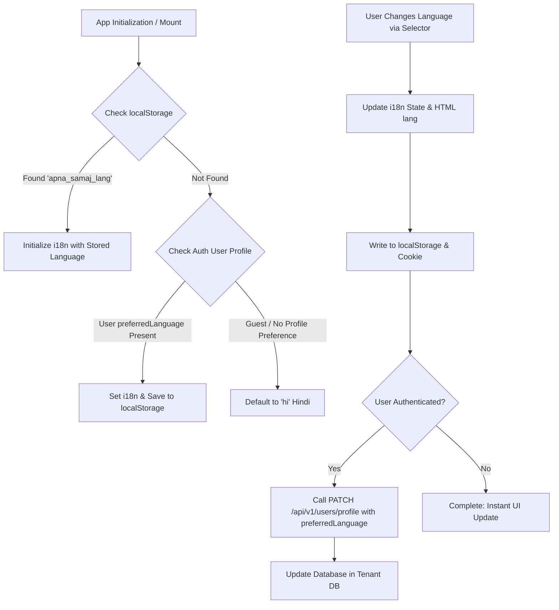
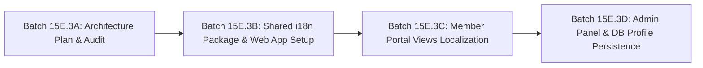

# Apna Samaj — Batch 15E.3A: Multilingual Architecture & Localization Plan

**Date:** October 31, 2026
**Auditor & Lead Architect:** Senior Frontend & Platform Architect
**Repository:** `ravindrakewat/ApnaSamaj` (`https://github.com/ravindrakewat/ApnaSamaj.git`)
**Current Branch:** `main`
**Current HEAD:** `4e7e615`
**Status:** ARCHITECTURAL SPECIFICATION & AUDIT (Read-only, no code modified)

---

## 1. Executive Summary

This document presents a comprehensive, production-grade architectural blueprint for introducing end-to-end multilingual capabilities across the Apna Samaj monorepo (`apps/web`, `apps/admin`, `apps/api`, and shared packages).

### Core Architectural Decisions:
1. **Primary & Default Language:** **Hindi (`hi`)** is established as the default first-class language across all member and administrative interfaces, with **English (`en`)** as the fully supported second language.
2. **Translation Engine:** Standardize on **`i18next`** and **`react-i18next`**, wrapped in a shared monorepo package (`packages/i18n` or `@apnasamaj/i18n`) for shared terminology, with application-specific namespaces for `web` and `admin`.
3. **No Breaking URL Rewrites:** Localization state is decoupled from routing paths (`/feed`, `/groups`, `/directory` remain constant without `/hi/` or `/en/` path prefixes), preserving all existing deep links, test suites, and bookmarks.
4. **Strict Separation of UI Chrome vs. User Content:** All user-generated content (posts, comments, group names, member bios, chat messages) remains strictly untouched in its original script/language. Only application chrome, system notifications, form labels, errors, and empty states are translated.
5. **Two-Tier Persistence:**
   - **Tier 1 (Instant / Guests):** `localStorage` (`apna_samaj_lang`) + cookie for zero layout flash during Vite client mount.
   - **Tier 2 (Cross-Device / Authenticated):** Persisted in member profile (`Profile.preferredLanguage`), automatically synchronizing across devices upon login.

---

## 2. Monorepo Codebase Audit & Existing State

A comprehensive inspection of the current repository revealed the following architectural state:

| Monorepo Package / App | Current Localization State | Audit Finding |
|:---|:---|:---|
| **`apps/web`** | **Fragmented / Partially Hindi** | `Navbar.tsx` has hardcoded Hindi buttons (`होम`, `समाज अपडेट्स`, `समूह`, etc.). `FeedPage.tsx` has 119 hardcoded Hindi tokens. `ForgotPasswordPage` and `ResetPasswordPage` have Hindi labels. Conversely, `NotificationBell.tsx`, `LoginPage`, `RegisterPage`, `DirectoryPage`, `GroupsPage`, and `ProfilePage` are entirely in English. |
| **`apps/admin`** | **100% English** | Zero Hindi tokens found. Navigation items in `AdminLayout.tsx` (`Member Management`, `Moderation Queue`, `Audit Logs`, etc.) and all admin tables/modals are strictly hardcoded English strings. |
| **`apps/api`** | **Bilingual Notifications** | API error messages are English. In Batch 15E.2, user-facing notifications for `ACCOUNT_STATUS_UPDATE` and `MATRIMONIAL_PROFILE_APPROVED/REJECTED` were localized to Hindi + English. |
| **`packages/database`** | **No Language Fields** | Prisma schema models [`User`](file:///c:/sunil%20kewat/dsas158/ApnaSamaj/packages/database/prisma/schema.prisma#L144) and [`Profile`](file:///c:/sunil%20kewat/dsas158/ApnaSamaj/packages/database/prisma/schema.prisma#L178) contain no `preferredLanguage` or `locale` attribute. |
| **`packages/ui-config`** | **Latin-first Font Stack** | `baseThemeOptions.typography.fontFamily` defines standard system fonts (`-apple-system, BlinkMacSystemFont, "Segoe UI", Roboto...`) without Devanagari font optimizations. |
| **`packages/validation`** | **No Language Enum** | `updateProfileSchema` in `auth.ts` does not include `preferredLanguage`. |

---

## 3. Recommended Library & Dependency Placement

### 3.1 Library Selection: `i18next` + `react-i18next`
We recommend the industry-standard `i18next` ecosystem:
- **`i18next`** (~10 kB gzipped): Core translation framework providing interpolation, pluralization rules, and nested keys.
- **`react-i18next`** (~4 kB gzipped): React hooks (`useTranslation`), HOCs, and `<Trans />` components.
- **`i18next-browser-languagedetector`**: Automatic language resolution hierarchy (`localStorage` -> user setting -> navigator -> default `'hi'`).

### 3.2 Monorepo Architecture: `@apnasamaj/i18n` Shared Package

Create a lightweight workspace package: `packages/i18n` (`@apnasamaj/i18n`).

```text
packages/i18n/
├── package.json
├── tsconfig.json
├── src/
│   ├── index.ts                  # Exports constants, helper functions, types
│   ├── types.ts                  # SupportedLanguage = 'hi' | 'en', TranslationNamespaces
│   ├── constants.ts              # DEFAULT_LANGUAGE = 'hi', SUPPORTED_LANGUAGES = ['hi', 'en']
│   └── locales/
│       ├── hi/                   # Devanagari Hindi Resources
│       │   ├── common.json       # Actions (सेव, हटाएं, रद्द, लोड हो रहा है, इत्यादि)
│       │   ├── nav.json          # Navigation links
│       │   ├── auth.json         # Login, Register, Password Reset
│       │   ├── feed.json         # Posts, Comments, Likes, Filter tabs
│       │   ├── groups.json       # Community Groups, Roles, Members
│       │   ├── directory.json    # Member Directory, Sub-castes, Search
│       │   ├── matrimonial.json  # Matrimonial discovery, preferences, interests
│       │   ├── notifications.json# In-app notifications dropdown & alerts
│       │   ├── appeals.json      # Moderation appeals
│       │   ├── profile.json      # Profile editing & App settings
│       │   └── admin.json        # Admin management, Moderation queue, Audit logs
│       └── en/                   # English Resources
│           ├── common.json
│           ├── nav.json
│           ├── auth.json
│           ...
```

### 3.3 Dependency Placement
- `packages/i18n`: Contains JSON translation catalogs, schema definitions, and type guards.
- `apps/web`: Depends on `@apnasamaj/i18n`, `i18next`, `react-i18next`.
- `apps/admin`: Depends on `@apnasamaj/i18n`, `i18next`, `react-i18next`.
- `packages/ui-config`: Updates MUI typography to include Devanagari font families:
  ```ts
  fontFamily: [
    'Noto Sans Devanagari',
    'Poppins',
    '-apple-system',
    'BlinkMacSystemFont',
    '"Segoe UI"',
    'Roboto',
    'sans-serif',
  ].join(','),
  ```

---

## 4. Language Selector Locations & User Experience

### 4.1 Web App Navbar (`apps/web/src/components/Navbar.tsx`)
- **Visual Design:** An accessible icon button with a translation/globe icon and language pill (e.g. `🌐 हिंदी / EN`).
- **Placement:** Positioned in the main toolbar immediately to the left of `<NotificationBell />`.
- **Interaction:**
  - Clicking opens a lightweight MUI `Menu`.
  - Options:
    - `🇮🇳 हिंदी (Hindi)` — marked with checkmark when active.
    - `🇬🇧 English` — marked with checkmark when active.
- **Mobile UX:** Renders as an icon button on small screens so it never overflows the toolbar.

### 4.2 Web App Profile / Settings (`apps/web/src/pages/ProfilePage.tsx`)
- Add an **"ऐप प्राथमिकताएं / App Preferences"** card in `ProfilePage.tsx`.
- Displays:
  - **भाषा चयन (Language Selection):** Radio buttons or Select dropdown allowing the member to toggle between `हिंदी (Hindi)` and `English (अंग्रेज़ी)`.
  - Explanatory note: *"आपके द्वारा चुनी गई भाषा आपके सभी डिवाइस पर सुरक्षित रहेगी।"* (*"Your selected language will be saved across all your devices."*)
  - Selecting an option updates `localStorage`, invokes `i18n.changeLanguage(lang)`, and synchronizes with the user's profile on the backend.

### 4.3 Admin Panel Layout (`apps/admin/src/components/AdminLayout.tsx`)
- **AppBar Placement:** Positioned in the fixed top `AppBar` to the right of the Community Switcher (for `SUPER_ADMIN`) and to the left of the `User Role` chip.
- **Drawer Placement:** In the mobile navigation drawer footer, provide an inline toggle button group (`[ हिंदी | EN ]`) for immediate accessibility on mobile admin devices.

---

## 5. Persistence Strategy & Database Migration Considerations

### 5.1 Dual-Tier Persistence Architecture



### 5.2 Database Schema Migration Analysis

To persist language preference across devices for authenticated users:
- **Recommended Model:** Add `preferredLanguage` to the `Profile` model in `packages/database/prisma/schema.prisma`:
  ```prisma
  model Profile {
    id                String    @id @default(uuid())
    userId            String    @unique
    user              User      @relation(fields: [userId], references: [id], onDelete: Cascade)
    fullName          String
    preferredLanguage String    @default("hi") // 'hi' | 'en'
    // ... existing fields ...
  }
  ```
- **Migration Safety Protocol (`AGENTS.md`):**
  - Physical database isolation must be preserved across Supabase tenant instances (`kewat`, `gupta`).
  - Adding a non-null column with `@default("hi")` is completely non-destructive (table does not require exclusive rewrite lock).
  - **Implementation Sequence:**
    1. Phase 1 operates purely client-side via `localStorage` (Zero database changes, zero risk of migration disruption).
    2. Phase 2 introduces `Profile.preferredLanguage` via verified staging migration.

---

## 6. Translation Structure & Key Conventions

### 6.1 Namespacing Structure
To avoid monolithic JSON files and maintain performance, translation keys are divided into logical namespaces:

```json
// packages/i18n/src/locales/hi/nav.json
{
  "home": "होम",
  "feed": "समाज अपडेट्स",
  "groups": "समूह",
  "directory": "सदस्य",
  "matrimonial": "विवाह परिचय",
  "profile": "मेरी प्रोफ़ाइल",
  "appeals": "अपील",
  "login": "लॉग इन",
  "register": "पंजीकरण",
  "logout": "लॉग आउट"
}
```

```json
// packages/i18n/src/locales/en/nav.json
{
  "home": "Home",
  "feed": "Community Feed",
  "groups": "Groups",
  "directory": "Directory",
  "matrimonial": "Matrimonial",
  "profile": "My Profile",
  "appeals": "Appeals",
  "login": "Login",
  "register": "Register",
  "logout": "Log Out"
}
```

### 6.2 Interpolation & Pluralization
`i18next` supports natural pluralization:
```json
// packages/i18n/src/locales/hi/feed.json
{
  "searchPlaceholder": "समाज की पोस्ट खोजें...",
  "emptyFeed": "अभी तक कोई पोस्ट नहीं की गई है। पहली पोस्ट बनाकर शुरुआत करें!",
  "likes_one": "{{count}} पसंद",
  "likes_other": "{{count}} पसंद",
  "comments_one": "{{count}} टिप्पणी",
  "comments_other": "{{count}} टिप्पणियाँ",
  "share": "शेयर करें"
}
```

### 6.3 Scalability for Future Indian Languages
Adding Marathi (`mr`), Gujarati (`gu`), Bhojpuri (`bho`), or Bengali (`bn`) in the future requires:
1. Creating `packages/i18n/src/locales/mr/` with identical JSON keys.
2. Appending `'mr'` to `SUPPORTED_LANGUAGES`.
3. Adding `'मराठी'` to the Language Selector menu.
Zero application code in `apps/web` or `apps/admin` needs to be rewritten.

---

## 7. Strict Separation of Chrome vs. User-Generated Content (UGC)

A fundamental multi-tenant community principle:

| UI Category | Translation Rule | Handling Mechanism |
|:---|:---|:---|
| **App Chrome** (Navbar, Tabs, Footers) | **Translated** | `t('nav.feed')`, `t('common.cancel')` |
| **System Labels** (Status, Post Type) | **Translated** | `t(`feed.postTypes.${post.type}`)` |
| **Form Labels & Placeholders** | **Translated** | `t('profile.fullNameLabel')`, `placeholder={t('feed.searchPlaceholder')}` |
| **User Posts & Comments** | **NOT Translated** | Rendered verbatim as stored: `{post.content}`, `{comment.content}` |
| **Group Names & Descriptions** | **NOT Translated** | Rendered verbatim: `{group.name}`, `{group.description}` |
| **User Profiles (Name, Bio, City)** | **NOT Translated** | Rendered verbatim: `{profile.fullName}`, `{profile.bio}` |
| **Chat Messages** | **NOT Translated** | Rendered verbatim: `{message.content}` |

---

## 8. Compatibility with System Invariants

1. **Multi-Tenant Isolation:**
   - Localization is purely orthogonal to tenant databases (`x-community-slug`).
   - A member of Kewat Samaj and a member of Gupta Samaj can both select Hindi or English independently.
2. **Authentication & Session Tokens:**
   - Access tokens (`verifyAccessToken`) and refresh tokens remain completely untouched.
   - Authentication headers and cookies are unchanged.
3. **HTTP API Contracts:**
   - REST endpoints continue returning standard JSON (`ApiResponse<T>`).
   - The web client automatically attaches `Accept-Language: hi` (or `en`) to outgoing requests via `api.client.ts`, allowing future backend SMS/email templates to align with client preferences.
4. **Deep Linking & SEO:**
   - URLs remain `/posts/:id`, `/groups/:id`, `/directory`. No routing regressions or nested `/hi/` prefixes.

---

## 9. Phased Implementation Roadmap



### Phase 1: Planning & Audit (Current Batch 15E.3A)
- Deliver comprehensive architectural audit report: `BATCH_15E_3A_MULTILINGUAL_ARCHITECTURE_PLAN.md`.
- Read-only; zero changes to application code.

### Phase 2: Shared i18n Foundation & Web App Layout (Batch 15E.3B)
1. Initialize `@apnasamaj/i18n` workspace package with Hindi and English base dictionaries (`common.json`, `nav.json`, `auth.json`, `notifications.json`).
2. Install `i18next`, `react-i18next`, `i18next-browser-languagedetector` in `apps/web`.
3. Add `LanguageSelector` component in `apps/web/src/components/LanguageSelector.tsx`.
4. Integrate selector into `Navbar.tsx` (next to `NotificationBell`).
5. Update `packages/ui-config/src/theme.ts` font stack to prioritize Devanagari typography (`Noto Sans Devanagari`, `Poppins`).
6. Automated unit tests verifying `localStorage` persistence and language switching.

### Phase 3: Member Portal Views Localization (Batch 15E.3C)
1. Localize `FeedPage.tsx` (extract 119 hardcoded Hindi strings into `feed.json`).
2. Localize `NotificationBell.tsx` into Hindi & English (`notifications.json`).
3. Localize `DirectoryPage.tsx` and `GroupsPage.tsx` (`directory.json`, `groups.json`).
4. Localize `LoginPage.tsx`, `RegisterPage.tsx`, `ForgotPasswordPage.tsx`, `ResetPasswordPage.tsx` (`auth.json`).
5. Localize `ProfilePage.tsx` and add the "App Preferences / भाषा चयन" settings card.
6. Automated UX regression tests across all localized pages.

### Phase 4: Admin Panel & Profile Persistence (Batch 15E.3D)
1. Initialize `i18n` in `apps/admin`.
2. Add Language Selector in `AdminLayout.tsx` top AppBar and mobile drawer.
3. Localize Admin navigation items, tables, moderation queue, and modals (`admin.json`).
4. Introduce optional `preferredLanguage` column in `Profile` with staging migration dry-run.
5. Update `updateMyProfile` to synchronize language preference across devices.

---

## 10. Clear Recommendation for Next Batch

We recommend proceeding with **Batch 15E.3B: Shared i18n Foundation & Web App Navigation Localization**:
- Create `@apnasamaj/i18n` workspace package.
- Set Hindi (`hi`) as the default language with English (`en`) support.
- Implement the Navbar `LanguageSelector` component with `localStorage` persistence.
- Localize `Navbar.tsx` and `NotificationBell.tsx` cleanly without touching databases or migrations.
