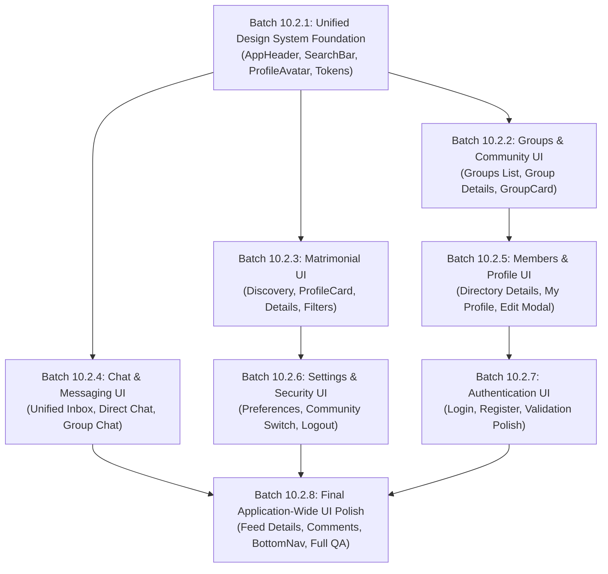

# Batch 10.2 — Complete Mobile UI Architecture Audit & Unified Design System Plan

**Date:** November 11, 2026  
**Status:** AUDIT & PLANNING COMPLETE (Zero Application Code Modified)  
**Target Platforms:** Android & iOS (React Native 0.76.9 + Expo SDK 52 + Expo Router v4)  
**Authoritative Git Baseline:** `f4e4d3ae5b25b24d6aa80178cf371c196a2259fa` (main)  
**Previous Baseline:** `9143c77c1e04984246cc08f3847c38ef6cdb6713`  

---

## 1. Executive Summary & Audit Mandate

The objective of **Batch 10.2** is to conduct a complete, unsparing architectural audit of every screen, component, token, and navigation flow in the Apna Samaj Mobile application (`apps/mobile`), and to establish a unified, production-ready design system plan to modernize all mobile screens.

This audit strictly enforces the following rules:
- **Audit & Planning Only:** Zero application source files, database schemas, API contracts, or dependencies have been modified.
- **Working Tree Preservation:** All existing uncommitted changes (Batch 10.1.2 Member Directory redesign) are preserved intact.
- **Fact-Based Screen Discovery:** Every documented screen maps to an inspected file path in `apps/mobile/app/`. Unimplemented screens (such as mobile Forgot Password or multi-step Matrimonial Wizard) are explicitly categorized as planned/missing, not claimed as completed.

---

## 2. Git Working Tree & Baseline Verification

```bash
$ git rev-parse HEAD
f4e4d3ae5b25b24d6aa80178cf371c196a2259fa

$ git branch --show-current
main

$ git status --short
 M apps/mobile/app/(app)/directory/index.tsx
 M apps/mobile/src/components/MemberCard.tsx
 M docs/MOBILE_APP_DEVELOPMENT_DASHBOARD.md
 M docs/PROJECT_HISTORY.md
?? docs/BATCH_10_1_2_MEMBER_DIRECTORY_UI_UX_REPORT.md
```

All 5 working tree modifications represent the verified, uncommitted work of Batch 10.1.2 (Member Directory UI/UX Redesign). No regressions or overwrites have taken place.

---

## 3. Phase 1: Complete Mobile Screen Discovery & Inventory

A comprehensive recursive discovery of `apps/mobile/app/` identified **17 route and layout files** representing **15 functional screens**, **2 layout files**, and **several embedded modal flows**:

| # | Screen / Route Name | Route URI | Source File Path | Navigation Type | Implementation Status |
| :-: | :--- | :--- | :--- | :--- | :---: |
| **—** | **Root Layout & Gate** | `/_layout` | `apps/mobile/app/_layout.tsx` | Root Stack + Auth Gate | **Active / Implemented** |
| **—** | **Auth Stack Layout** | `/(auth)/_layout` | `apps/mobile/app/(auth)/_layout.tsx` | Stack (Fade) | **Active / Implemented** |
| 1 | **Login Screen** | `/(auth)/login` | `apps/mobile/app/(auth)/login.tsx` | Auth Stack | **Active / Implemented** |
| 2 | **Registration Screen** | `/(auth)/register` | `apps/mobile/app/(auth)/register.tsx` | Auth Stack | **Active / Implemented** |
| **—** | *Forgot Password* | *Unimplemented* | *None (Pending)* | *N/A* | ❌ **Missing on Mobile** |
| **—** | *Password Reset* | *Unimplemented* | *None (Pending)* | *N/A* | ❌ **Missing on Mobile** |
| **—** | **App Stack Layout** | `/(app)/_layout` | `apps/mobile/app/(app)/_layout.tsx` | Stack (Headerless) | **Active / Implemented** |
| 3 | **Home Feed Screen** | `/(app)` or `/(app)/index` | `apps/mobile/app/(app)/index.tsx` | Tab 1 (Feed) | **Batch 10.1.1 Polished** |
| 4 | **Create Post Composer** | `/(app)/post/create` | `apps/mobile/app/(app)/post/create.tsx` | Stack (Modal/Full) | **Batch 10.1 Polished** |
| 5 | **Post Details & Comments** | `/(app)/post/[id]` | `apps/mobile/app/(app)/post/[id].tsx` | Stack | **Active / Needs Polish** |
| 6 | **Member Directory** | `/(app)/directory` | `apps/mobile/app/(app)/directory/index.tsx` | Tab 2 (Directory) | **Batch 10.1.2 Polished** |
| 7 | **Member Profile Details** | `/(app)/directory/[id]` | `apps/mobile/app/(app)/directory/[id].tsx` | Stack | **Active / Needs Polish** |
| 8 | **Community Groups Discovery** | `/(app)/groups` | `apps/mobile/app/(app)/groups/index.tsx` | Tab 3 (Groups) | **Active / Needs Polish** |
| 9 | **Group Details & Discussions** | `/(app)/group/[slug]` | `apps/mobile/app/(app)/group/[slug].tsx` | Stack | **Active / Needs Polish** |
| 10 | **Group Live Chat** | `/(app)/group/[slug]/chat` | `apps/mobile/app/(app)/group/[slug]/chat.tsx` | Stack | **Active / Needs Polish** |
| 11 | **Matrimonial Discovery** | `/(app)/matrimonial` | `apps/mobile/app/(app)/matrimonial/index.tsx` | Tab 4 (Matrimony) | **Active / Needs Polish** |
| 12 | **Matrimonial Profile Details** | `/(app)/matrimonial/[id]` | `apps/mobile/app/(app)/matrimonial/[id].tsx` | Stack | **Active / Needs Polish** |
| **—** | *Matrimonial Wizard* | *Embedded modal* | *Within matrimonial/index.tsx* | *Modal/Wizard* | ⚠️ **Needs Dedicated Screen** |
| 13 | **Unified Chat Inbox** | `/(app)/chat` | `apps/mobile/app/(app)/chat/index.tsx` | Tab 5 (Chat) | **Active / Needs Polish** |
| 14 | **Direct 1-on-1 Chat** | `/(app)/chat/[id]` | `apps/mobile/app/(app)/chat/[id].tsx` | Stack | **Active / Needs Polish** |
| 15 | **My Profile** | `/(app)/profile` | `apps/mobile/app/(app)/profile/index.tsx` | Tab 6 (Profile) | **Active / Needs Polish** |
| 16 | **Profile Settings & Security** | `/(app)/profile/settings` | `apps/mobile/app/(app)/profile/settings.tsx` | Stack | **Active / Needs Polish** |

### Breakdown by Functional Domain

#### A. Authentication Domain
- **Login (`/(auth)/login.tsx`):** Implements phone number normalization, password input with visibility toggle, community slug input, language toggle, and navigation to registration.
- **Register (`/(auth)/register.tsx`):** Implements required fields (fullName, phone, password, communitySlug) and collapsible optional roots fields (gender, city, state, subCaste, gotra).
- **Missing / Unimplemented:** No mobile route exists for `forgot-password` or `reset-password`. Users currently cannot self-reset passwords on mobile without using the web app (`apps/web`).

#### B. Social Feed Domain
- **Home Feed (`/(app)/index.tsx`):** Fully modernized in Batch 10.1.1 with branded header, Facebook-style composer prompt, category filter pills, rounded search, inline video playback with low-RAM auto-pause, and floating action button.
- **Create Post (`/(app)/post/create.tsx`):** Fully modernized in Batch 10.1 with 6 selectable category cards, live character counters, media upload tiles, 2×2 photo grid, dark video progress card, and sticky publish bar.
- **Post Details (`/(app)/post/[id].tsx`):** Implements post content, media, inline video player, author details, like/unlike toggling, paginated comments, and sticky comment composer. Uses Stack default header (`headerShown: true`), which creates a visual mismatch with custom headers.

#### C. Members Domain
- **Member Directory (`/(app)/directory/index.tsx`):** Fully modernized in Batch 10.1.2 with compact top navbar, rounded search, active filter pills carousel, slide-up filter bottom sheet (Gotra, State, City, Sub-Caste), and FlatList virtualization.
- **Member Profile Details (`/(app)/directory/[id].tsx`):** Implements public member profile by UUID: 72×72 avatar, role badge, community slug, joined date, location, sub-caste, gotra, bio snippet, and "निजी संदेश भेजें" (Send Direct Message) action button connecting to `chatApi.createDirectConversation`.

#### D. Groups & Community Domain
- **Groups Discovery (`/(app)/groups/index.tsx`):** Implements search, filter tabs (`ALL`, `MY`, `PUBLIC`, `PRIVATE`), paginated list with `GroupCard`, and join group button.
- **Group Details (`/(app)/group/[slug].tsx`):** The exact screen highlighted in the user request. Features group cover/logo, Public/Private badge, community slug pill, member and post count, description, member role badge (`ADMIN`, `MODERATOR`, `MEMBER`), Join/Leave actions with sole-admin validation, Live Group Chat banner CTA, discussion posts list with like toggling, and locked-access card for private groups.
- **Group Chat (`/(app)/group/[slug]/chat.tsx`):** Full real-time group chat with Socket.IO, audio recording, media attachments, search, and reactions.

#### E. Matrimonial Domain
- **Discovery (`/(app)/matrimonial/index.tsx`):** Dual-tab interface (`profiles` vs `interests`), multi-criteria filters (gender, marital status, manglik, sub-caste, city), send interest modal, and interest response management (Accept / Decline).
- **Profile Details (`/(app)/matrimonial/[id].tsx`):** 1102-line comprehensive detail screen featuring multi-photo viewer, personal stats (age, height, weight, mother tongue), horoscope/kundali details, family background, lifestyle, partner expectations, send interest modal, profile reporting dialog, and member blocking.

#### F. Chat & Messaging Domain
- **Unified Inbox (`/(app)/chat/index.tsx`):** Multi-tab inbox (`ALL`, `PERSONAL`, `GROUPS`), unread counters, last message previews, search filter, and real-time Socket.IO synchronization.
- **Direct Chat (`/(app)/chat/[id].tsx`):** One-to-one conversation screen with message history, delivery/read receipts (`✓✓`), audio player with waveform scrubber, photo/video/doc viewer, quoted replies, emoji reactions, message deletion ("Delete for Me" / "Delete for Everyone"), and voice note recorder.

#### G. Profile & Settings Domain
- **My Profile (`/(app)/profile/index.tsx`):** User profile screen with avatar image upload (`expo-image-picker`), stats overview, edit profile modal (fullName, gender, bio, location, gotra, subCaste), and roots summary.
- **Settings (`/(app)/profile/settings.tsx`):** Language switcher (Hindi/English), community switcher, notification preferences switches (7 toggleable event types), and account logout with confirmation.

---

## 4. Phase 2: Existing UI Architecture & Inconsistency Audit

### A. Theme Tokens (`apps/mobile/src/theme/`)
- **Colors (`colors.ts`):** Well-defined primary blue (`#1976D2`), dark primary (`#1565C0`), surface (`#FFFFFF`), background (`#F8FAFC`), and semantic colors (`#16A34A`, `#DC2626`, `#F59E0B`, `#0284C7`).
- **Typography (`typography.ts`):** System fonts for iOS and `sans-serif` for Android with scale from `xxs` (10) to `display` (32).
- **Border Radius (`borderRadius.ts`):** 4pt to 24pt scale.
- **Spacing (`spacing.ts`):** Standard 4pt grid system (`sm: 8`, `md: 12`, `lg: 16`, `xl: 20`, `xxl: 24`).
- **Shadows (`shadows.ts`):** Platform-aware shadow definitions with Android elevation (1 to 4) and iOS shadow offsets.

### B. Identified Inconsistencies Across Screens

| Architectural Area | Current State & Inconsistency | Recommended Unified Standard |
| :--- | :--- | :--- |
| **Top Headers** | Hand-rolled in nearly every screen. `post/[id].tsx` uses Stack native header; `group/[slug].tsx` uses a simple row with `←`; `index.tsx` and `directory/index.tsx` use a custom branded header with badge and language pill. | Create unified `AppHeader` supporting: brand mode (Feed/Directory), title mode with back button (Details screens), action buttons, and language switcher. |
| **Search Bars** | Implemented differently in Feed, Directory, Groups, and Chat. Some use `Input`, some use raw `TextInput`, some have clear buttons, others lack them. | Create unified `SearchBar` component with magnifying glass icon `🔍`, instant clear button `✕`, rounded pill container (`borderRadius: 22`), and optional filter trigger button. |
| **Filter Triggers & Chips** | Active filter chips are horizontal pills in Feed and Directory, but segmented tabs in Groups and Chat, and an expandable card in Matrimony. | Unify into `FilterChips` and a standard slide-up `BottomSheet` filter modal across Directory, Groups, and Matrimonial. |
| **Card Radii & Spacing** | Card border radii vary from `8px` (`borderRadius.md`), `10px`, `12px` (`borderRadius.lg`) to `16px`. Card padding varies from `10px` to `16px`. | Standardize all content cards to `borderRadius: 12` (`theme.borderRadius.lg`), border `1px #E2E8F0`, padding `12px` to `14px`, and subtle card shadow. |
| **Bottom Navigation Padding** | BottomNavigation is absolutely positioned (`height: ~60px`). In some screens (`groups/index.tsx`, `chat/index.tsx`), FlatList padding is only `24px`, which partially hides bottom list items behind navigation tabs. | Standardize `contentContainerStyle` across all tab screens to `paddingBottom: Math.max(insets.bottom, 16) + 72`. |
| **Action Buttons & Badges** | Some badges use `Badge` component, others use inline `View` with hardcoded colors. Button heights vary between 36px, 40px, 44px, and 48px. | Enforce `Button` (`sm: 38px`, `md: 44px`, `lg: 50px`) and `Badge` tokens. |
| **Avatars & Fallbacks** | Avatars vary from 36px, 42px, 46px, 50px to 72px. Initial fallbacks use different background tints (`#E3F2FD`, `#E0F2FE`, `#F1F5F9`). | Standardize `ProfileAvatar` component with sizes: `sm: 36px`, `md: 44px`, `lg: 52px`, `xl: 72px`, with consistent soft blue background (`#E0F2FE`) and primary blue initial (`#0369A1`). |
| **Legacy VideoModal** | `group/[slug].tsx` still imports legacy `VideoModal` from Batch 9.1 instead of inline playback or `UnifiedVideoModal`. | Remove obsolete modal import and route video playback through the unified inline video player architecture. |

---

## 5. Phase 3: Unified Design System Proposal

To achieve complete visual harmony while strictly preserving Apna Samaj's **classic blue-and-white visual identity**, the unified design system defines standard tokens and 10 shared component contracts.

### A. Core Design Tokens

```typescript
export const unifiedTokens = {
  colors: {
    // Brand Primary
    primary: '#1976D2',        // Apna Samaj Classic Blue
    primaryDark: '#1565C0',    // Press state & active borders
    primaryLight: '#E0F2FE',   // Subtle badges, pills, avatar fallbacks
    primaryBorder: '#BAE6FD',  // Badge borders
    
    // Backgrounds & Surfaces
    background: '#F8FAFC',     // Clean slate off-white screen background
    surface: '#FFFFFF',        // Pure white card and container surface
    surfaceSubtle: '#F1F5F9',  // Subtle input backgrounds, secondary pills
    
    // Typography
    textPrimary: '#0F172A',    // High-contrast headings and titles
    textSecondary: '#334155',  // Body text, post content, descriptions
    textMuted: '#64748B',      // Secondary metadata, timestamps, location
    textSubtle: '#94A3B8',     // Placeholders, disabled text
    textInverse: '#FFFFFF',    // White text on primary buttons/badges
    
    // Borders
    border: '#E2E8F0',         // Universal card & input border
    borderFocus: '#1976D2',    // Input active focus ring
    
    // Functional States
    success: '#16A34A',
    successLight: '#DCFCE7',
    error: '#DC2626',
    errorLight: '#FEE2E2',
    warning: '#F59E0B',
    warningLight: '#FEF3C7',
    info: '#0284C7',
    infoLight: '#E0F2FE',
  },
  
  borderRadius: {
    xs: 4,
    sm: 6,
    md: 8,
    card: 12,                  // Standard for cards
    button: 10,                // Standard for buttons
    pill: 20,                  // Standard for badges, pills, search bars
    full: 9999,                // Circular avatars
  },
  
  shadows: {
    card: {
      elevation: 2,
      shadowColor: '#0F172A',
      shadowOffset: { width: 0, height: 1 },
      shadowOpacity: 0.05,
      shadowRadius: 3,
    },
    topBar: {
      elevation: 3,
      shadowColor: '#0F172A',
      shadowOffset: { width: 0, height: 1 },
      shadowOpacity: 0.06,
      shadowRadius: 3,
    },
    bottomNav: {
      elevation: 8,
      shadowColor: '#0F172A',
      shadowOffset: { width: 0, height: -2 },
      shadowOpacity: 0.08,
      shadowRadius: 5,
    },
  },
};
```

### B. Core Reusable Component Plan

1. **`AppHeader`:** Unified top navigation bar supporting:
   - **Mode `'brand'`:** Stylized community icon, screen title, community slug pill, language switcher, and profile avatar button (for Feed, Directory, Groups, Matrimony, Chat).
   - **Mode `'detail'`:** Left back chevron `←`, screen title, optional right action (for Post Details, Member Profile, Group Details, Chat Conversation, Settings).
2. **`SearchBar`:** Rounded container (`borderRadius: 22`) with magnifying glass icon `🔍`, text input, clear button `✕`, and optional filter trigger button with active count badge.
3. **`ProfileAvatar`:** High-performance circular image with graceful fallback to initials on soft blue background (`#E0F2FE`), supported in sizes `xs (28)`, `sm (36)`, `md (44)`, `lg (52)`, `xl (72)`.
4. **`FilterChips`:** Horizontal scroll of selectable or dismissible chips with high-contrast active state.
5. **`BottomSheet`:** Animated slide-up modal with backdrop dismissal, drag handle bar, structured form fields, and "Clear / Apply" action footer.
6. **`EmptyState` & `ErrorState`:** Standardized empty and error cards with localized bilingual text and actionable retry/refresh buttons.
7. **`GroupCard`:** Modernized community group card with 50px cover/fallback, public/private badge, member count, post count, and join/view affordance.
8. **`MatrimonialProfileCard`:** Modern matrimonial card with responsive photo, age, height, education, occupation, gotra, manglik status, city, and interest trigger.
9. **`StatusBadge`:** Standardized status pill (`success`, `warning`, `error`, `info`, `default`).
10. **`BottomNavigation`:** Preserved 6-tab fixed bottom bar with active indicator line and safe-area bottom inset.

---

## 6. Phase 4: Screen-by-Screen UI Audit & Modernization Specs

### 1. Login Screen (`apps/mobile/app/(auth)/login.tsx`)
- **Current Condition:** Functional 3-field form (Phone, Password, Slug) inside a simple card.
- **Problems:** Typography is plain; language toggle is an unstyled link; logo is a plain text character; lacks modern branding polish.
- **Recommended Improvements:** Modern branded header with stylized 'अ' icon, clear bilingual welcoming copy, rounded inputs with icons, high-contrast primary login button, and language switcher pill.
- **Regression Risks:** Phone normalization (`validatePhone`) and multi-tenant slug routing must remain untouched.

### 2. Registration Screen (`apps/mobile/app/(auth)/register.tsx`)
- **Current Condition:** Long vertical form with collapsible optional section for roots fields.
- **Problems:** Visual density is high; form inputs lack visual grouping; toggle button for optional fields is basic.
- **Recommended Improvements:** Clean section headers ("आवश्यक जानकारी" vs "पारिवारिक व मूल जानकारी"), modern gender selection chips, formatted city/state inputs, and prominent submit button.
- **Regression Risks:** Password length validation and optional profile fields matching backend Prisma schema must be preserved.

### 3. Post Details & Comments Screen (`apps/mobile/app/(app)/post/[id].tsx`)
- **Current Condition:** PostCard at top, comments list below, sticky input at bottom.
- **Problems:** Uses native Stack header (`headerShown: true`) while all other screens use custom headers; comment input bar lacks safe-area keyboard inset handling on some Android keyboards.
- **Recommended Improvements:** Replace native header with custom detail `AppHeader` (back button + "चर्चा विवरण" title); use redesigned `PostCard`; style comment items with circular avatars, light gray reply cards, relative timestamps, and floating comment composer.
- **Regression Risks:** Comment pagination and view-recording trigger must remain intact.

### 4. Member Profile Details (`apps/mobile/app/(app)/directory/[id].tsx`)
- **Current Condition:** Large avatar, role badge, roots section, location, bio, and "Start Chat" button.
- **Problems:** Header uses basic back button; roots info is displayed in flat unstyled rows; lacks modern card grouping.
- **Recommended Improvements:** Custom detail `AppHeader`, 72×72 circular avatar with primary ring, modern stats row (सदस्यता काल, शहर, राज्य), structured card sections for "मूल व गोत्र" and "व्यक्तिगत परिचय", and elevated primary "निजी संदेश भेजें" button with chat icon `💬`.
- **Regression Risks:** Must never expose phone numbers, emails, or sensitive hashes.

### 5. Community Groups Discovery (`apps/mobile/app/(app)/groups/index.tsx`)
- **Current Condition:** Filter tabs (`ALL`, `MY`, `PUBLIC`, `PRIVATE`), search bar, and `GroupCard` list.
- **Problems:** Top header doesn't match Feed and Directory; search bar is a plain Input; filter tabs look like plain text tabs without pill styling.
- **Recommended Improvements:** Adopt unified `AppHeader` (brand mode with 🏛️ icon); replace search bar with unified `SearchBar`; modernize filter tabs into horizontal pill chips with active primary blue background; polish `GroupCard`.
- **Regression Risks:** Privacy filter logic (`privacy: 'PUBLIC' | 'PRIVATE'`) and join group optimistic update must be preserved.

### 6. Group Details Screen (`apps/mobile/app/(app)/group/[slug].tsx`)
- **Current Condition:** Hero card with cover/logo, badges, description, Join/Leave action, Live Chat CTA, and discussions FlatList.
- **Problems:** Header is a bare row with `←`; still imports deprecated `VideoModal`; action buttons lack visual hierarchy; discussion empty state is plain text.
- **Recommended Improvements:**
  - **Top Bar:** Modern detail `AppHeader` with `←` back button, bold group title, and community slug badge.
  - **Hero Card:** 60×60 rounded group cover/initial with soft blue background; Public/Private badge (`सार्वजनिक मंडल` vs `निजी समूह`); member count (`👥 12 सदस्य`) and post count (`💬 4 चर्चाएं`) in formatted pills.
  - **Description & Objectives:** Readable typography with 14px text and proper line spacing.
  - **Role & Action Bar:** Primary "समूह से जुड़ें" (Join) button or outline "समूह छोड़ें" (Leave) button with sole-admin confirmation modal.
  - **Live Group Chat CTA:** Elevated green pill container (`#DCFCE7` icon box, bold title, right arrow `→`) navigating to `/(app)/group/${slug}/chat`.
  - **Discussions Stream:** Seamless inline `PostCard` items with like toggling and inline video playback.
  - **Private Group Guard:** High-contrast locked card with 🔒 icon for unauthorized non-members.
- **Regression Risks:** Membership state checks (`isMember`, `myRole`), sole-admin leave restrictions, and private group discussion isolation must remain 100% intact.

### 7. Group Live Chat (`apps/mobile/app/(app)/group/[slug]/chat.tsx`)
- **Current Condition:** Full-featured real-time chat screen with Socket.IO, audio waveforms, attachments, search, and reactions.
- **Problems:** Header styling is slightly inconsistent with 1-on-1 chat; attachment buttons can be aligned more cleanly.
- **Recommended Improvements:** Modern WhatsApp-style header with group avatar, name, and live participant count; clean bubble layout with rounded corners; modern message status icons; unified attachment action sheet.
- **Regression Risks:** Socket.IO event listeners, outbox offline queue, and attachment upload pipelines must be preserved.

### 8. Matrimonial Discovery Screen (`apps/mobile/app/(app)/matrimonial/index.tsx`)
- **Current Condition:** Primary tab switch (`profiles` vs `interests`), expandable filter card, and profile cards stream.
- **Problems:** Filter card occupies too much vertical space when expanded; tab switch is basic; profile cards have cramped typography.
- **Recommended Improvements:** Unified `AppHeader` (brand mode with 💍 icon); segmented tab pills (`वर-वधू खोजें` vs `प्राप्त/भेजे गए प्रस्ताव`); slide-up `BottomSheet` filter modal (Gender, Marital Status, Manglik, City, Sub-Caste); active filter chips carousel; modernized `MatrimonialCard`.
- **Regression Risks:** Multi-criteria filter query params and interest response APIs (`acceptInterest`, `declineInterest`) must remain untouched.

### 9. Matrimonial Profile Details (`apps/mobile/app/(app)/matrimonial/[id].tsx`)
- **Current Condition:** 1102-line rich detail screen with multi-photo viewer, horoscope, lifestyle, and interest modal.
- **Problems:** Photos carousel lacks thumbnail indicator bar; text sections lack card elevation; action buttons are stacked at the very bottom.
- **Recommended Improvements:** Full-width hero image with pagination dots (`1/4`); modern segmented detail tabs ("व्यक्तिगत", "पारिवारिक", "कुंडली व मूल", "अपेक्षाएं"); sticky bottom action bar with "प्रस्ताव भेजें" (Send Interest) primary button; clean report and block modals.
- **Regression Risks:** Photo index bounds and interest submission contracts must be preserved.

### 10. Unified Chat Inbox (`apps/mobile/app/(app)/chat/index.tsx`)
- **Current Condition:** Three-tab inbox (`ALL`, `PERSONAL`, `GROUPS`), unread counters, and conversation items.
- **Problems:** Header lacks branded slug pill; tab pills have basic styling; unread badges are small.
- **Recommended Improvements:** Unified `AppHeader` (brand mode with 💬 icon); modern rounded pill tabs; conversation row with 48px avatar/cover, bold name, relative timestamp, last message snippet, and prominent green unread count pill (`#16A34A`); search bar at top.
- **Regression Risks:** Socket.IO real-time message updates and unread count aggregation must remain untouched.

### 11. Direct 1-on-1 Chat (`apps/mobile/app/(app)/chat/[id].tsx`)
- **Current Condition:** Message stream with audio player, media gallery, reactions, replies, deletions.
- **Problems:** Header is hand-rolled; message bubbles could have softer gradients/radii; reply composer bar can be polished.
- **Recommended Improvements:** Modern chat header with contact avatar, name, online/active indicator, and media gallery shortcut icon; WhatsApp-style green/blue incoming and outgoing message bubbles; floating reaction bar; polished voice note waveform.
- **Regression Risks:** Message deletion ("Delete for Me" / "Delete for Everyone"), quoted reply navigation, and attachment security must remain untouched.

### 12. My Profile Screen (`apps/mobile/app/(app)/profile/index.tsx`)
- **Current Condition:** Avatar upload, profile fields, edit modal, and roots display.
- **Problems:** Edit modal inputs are unstyled; profile header is basic; avatar upload camera icon is slightly misaligned.
- **Recommended Improvements:** Unified `AppHeader` (brand mode with 👤 icon); modern hero card with 80×80 avatar, camera badge button, verified community role pill (`व्यवस्थापक` / `सदस्य`), and stats chips; organized cards for "पारिवारिक पहचान", "मूल व गोत्र", and "स्थान"; polished edit profile modal with safe area inputs.
- **Regression Risks:** `usersApi.updateMyProfile` input validation and `expo-image-picker` permissions must remain untouched.

### 13. Profile Settings & Security (`apps/mobile/app/(app)/profile/settings.tsx`)
- **Current Condition:** Language picker, community switcher, notification preferences switches, and logout button.
- **Problems:** Switches are standard native switches without card grouping; community switcher input is basic; logout button is plain.
- **Recommended Improvements:** Custom detail `AppHeader` with `←` back button; clean grouped settings sections with icons:
  - 🌐 **भाषा प्राथमिकता (Language Preferences):** Hindi vs English toggle card.
  - 🏛️ **समुदाय बदलें (Switch Community):** Modern input with current community indicator.
  - 🔔 **सूचनाएं (Notification Preferences):** Card list with clean iOS/Android colored switches (`#1976D2`).
  - 🛡️ **सुरक्षा व सत्र (Security & Session):** Destructive logout button with icon and modern confirmation dialog.
- **Regression Risks:** Notification preference toggle debounce and multi-tenant `switchCommunity` session clear must remain untouched.

---

## 7. Phase 5: Implementation Roadmap & Batches

To guarantee zero regression and ensure each milestone is independently testable, the implementation is decomposed into **8 discrete batches**:



### Detailed Batch Breakdown

| Batch | Scope & Targets | Key Deliverables | Verification Strategy |
| :--- | :--- | :--- | :--- |
| **Batch 10.2.1** | **Unified Design System Foundation** | Create shared `AppHeader`, `SearchBar`, `ProfileAvatar`, `FilterChips`, and export them in `src/components/index.ts`. Verify color, typography, spacing, and shadow tokens. | Mobile unit tests + monorepo typecheck + zero screen regressions. |
| **Batch 10.2.2** | **Groups & Community UI** | Modernize `groups/index.tsx`, `GroupCard.tsx`, and `group/[slug].tsx` (Group Details) using `AppHeader`, `SearchBar`, and polished hero cards. Eliminate deprecated `VideoModal`. | Test group joining, leaving, sole-admin alert, discussions list, and private group isolation. |
| **Batch 10.2.3** | **Matrimonial UI** | Modernize `matrimonial/index.tsx`, `MatrimonialCard.tsx`, and `matrimonial/[id].tsx` with `AppHeader`, filter bottom sheet, tab pills, and photo gallery. | Test multi-criteria filter params, photo navigation, send interest modal, accept/decline flows. |
| **Batch 10.2.4** | **Chat & Messaging UI** | Modernize `chat/index.tsx`, `chat/[id].tsx`, and `group/[slug]/chat.tsx` with unified headers, conversation rows, unread counters, and bubble styling. | Test Socket.IO real-time messages, audio waveform playback, attachments, search, and reactions. |
| **Batch 10.2.5** | **Members & Profile UI** | Modernize `directory/[id].tsx`, `profile/index.tsx`, and edit profile modal with `ProfileAvatar`, structured cards, and image upload button. | Test profile viewing, direct chat initiation, profile updating, and avatar upload. |
| **Batch 10.2.6** | **Settings & Security UI** | Modernize `profile/settings.tsx` with grouped settings cards, colored switches, community switcher, and logout dialog. | Test language toggle, notification preferences persistence, and multi-tenant community switching. |
| **Batch 10.2.7** | **Authentication UI** | Modernize `login.tsx` and `register.tsx` with branded headers, rounded inputs, gender selector chips, and clear validation messages. | Test phone normalization, password validation, and auth session bootstrap. |
| **Batch 10.2.8** | **Final Application-Wide UI Polish** | Polish `post/[id].tsx` (Post Details & Comments), review `BottomNavigation` safe-area padding across all screens, and run full monorepo typecheck and test suite. | Full 344+ mobile test suite execution + monorepo build verification. |

---

## 8. Critical Functional Invariants & Regression Safety

During all subsequent batches, the following architecture invariants must never be breached:
1. **Multi-Tenant Context:** Every API request must retain the `x-community-slug` header bound through `apiClient`. Never drop tenant parameters.
2. **Physical Data Isolation:** No cross-community data bleeding or hardcoded central fallbacks.
3. **Low-RAM Single Active Video:** In the Feed and Group Discussions, strictly one video plays at a time with automatic decoder release when scrolled 40% out of view.
4. **Member Privacy Guarantee:** Never expose phone numbers, email addresses, or password hashes in public member or directory profiles.
5. **Private Group Enclosure:** Posts and member rosters of private groups must be strictly inaccessible to non-members.
6. **Chat Offline Idempotency:** Chat message sending must preserve `clientMessageId` for backend deduplication and offline FIFO synchronization.
7. **BottomNavigation Safe Insets:** Every scrollable screen must use `contentContainerStyle` with `paddingBottom: Math.max(insets.bottom, 16) + 72` to prevent UI obstruction.

---

## 9. Recommended First Implementation Task

Upon user authorization, the recommended first step is **Batch 10.2.1: Unified Design System Foundation**:
- Implement `AppHeader.tsx` (supporting both `'brand'` and `'detail'` modes).
- Implement `SearchBar.tsx` (reusable across Feed, Directory, Groups, and Chat).
- Implement `ProfileAvatar.tsx` (reusable across PostCard, MemberCard, Chat, and Profile).
- Export new components via `apps/mobile/src/components/index.ts`.
- Run typecheck and existing 344 mobile tests to verify zero regressions.

