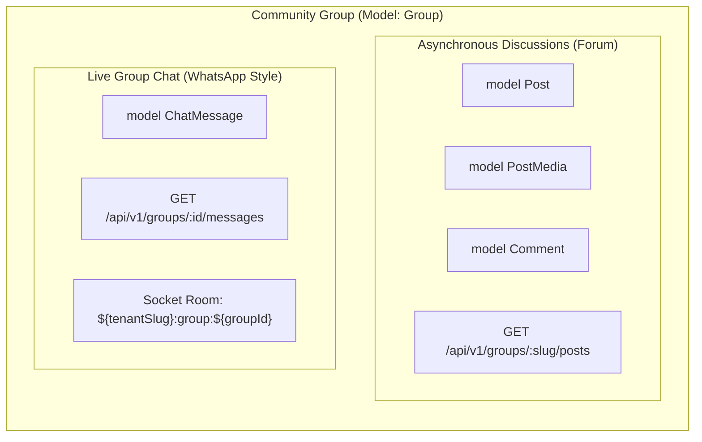
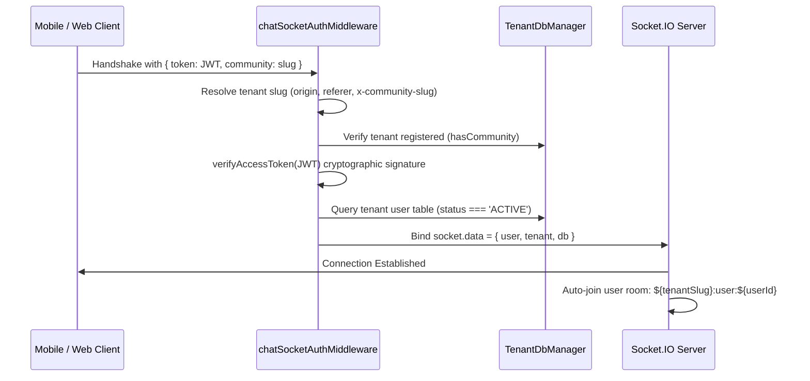
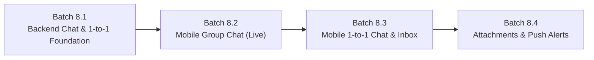

# Batch 8: Existing Backend Messaging Infrastructure Audit

**Date:** November 4, 2026  
**Auditor:** Apna Samaj Technical Assistant (DeepMind Pair Programmer)  
**Status:** COMPLETE (AUDIT ONLY — ZERO CODE MODIFICATIONS)  
**Target Platform:** Apna Samaj Monorepo (`apps/api`, `apps/web`, `apps/mobile`, `packages/database`, `packages/shared-types`, `packages/validation`)

---

## 1. Executive Summary

This technical audit examines the existing Chat and Messaging infrastructure across the Apna Samaj monorepo before beginning Mobile Chat development.

### Core Audit Findings at a Glance

| Area | Current Status | Implemented Components | Missing / Deficient Components |
| :--- | :---: | :--- | :--- |
| **Community Group Chat** | **Fully Functional** | `ChatMessage` Prisma model, REST endpoints (`GET/POST /api/v1/groups/:id/messages`), Socket.IO room broadcasting, typing indicators, cursor pagination, rate limiting. | Plain text only; no media attachments; no message deletion/editing; no read receipts. |
| **Personal (1-to-1) Chat** | **NOT IMPLEMENTED** | None. | No database models, no conversation endpoints, no direct message socket events, no recipient tracking. |
| **Unified Chat Inbox** | **NOT IMPLEMENTED** | None. | No conversation list, no aggregated last-message feed, no chat unread counters. |
| **Real-Time Engine** | **Fully Functional** | Socket.IO v4.8.4 on HTTP server (`/socket.io`), JWT auth handshake, strict tenant isolation via slug prefixing, rate limiting (1 msg/sec). | No presence tracking (online/last seen), no delivery acknowledgments, no direct message rooms. |
| **Web App Integration** | **Group Chat Only** | `GroupChatTab.tsx` inside `GroupDetailPage.tsx` with live socket stream, optimistic UI, typing indicator, auto-scroll. | No personal chat UI, no chat inbox screen, no media upload in chat. |
| **Push Notifications** | **NOT IMPLEMENTED** | In-app real-time socket alerts (`Notification` model + `notification:new` event) when app is open. | No FCM, no Expo Push Notifications, no APNs; zero background push capability. |
| **Media Attachments** | **NOT IMPLEMENTED** | Supabase storage exists for post media, avatars, and matrimonial docs. | No chat media bucket, no chat attachment upload endpoint, no attachment fields on messages. |

---

## 2. Existing Backend Architecture

### 2.1 Directory Structure
The existing backend chat infrastructure is located in:
- **`apps/api/src/modules/chat/`**:
  - [`chat.controller.ts`](file:///c:/sunil%20kewat/dsas158/ApnaSamaj/apps/api/src/modules/chat/chat.controller.ts): Express handlers for group message retrieval and HTTP message sending fallback.
  - [`chat.service.ts`](file:///c:/sunil%20kewat/dsas158/ApnaSamaj/apps/api/src/modules/chat/chat.service.ts): Business logic for cursor pagination, message creation, group access validation, and tenant client enforcement.
  - [`chat.socket.ts`](file:///c:/sunil%20kewat/dsas158/ApnaSamaj/apps/api/src/modules/chat/chat.socket.ts): Socket.IO server initialization, tenant authentication middleware, room management, rate limiting, and event handlers.
  - [`index.ts`](file:///c:/sunil%20kewat/dsas158/ApnaSamaj/apps/api/src/modules/chat/index.ts): Module exports.
- **`apps/api/src/modules/groups/groups.routes.ts`**:
  - The chat REST endpoints are mounted under `/api/v1/groups/:id/messages`.
  - There is currently **no standalone `/api/v1/chat` router** mounted in `apps/api/src/app.ts`.

### 2.2 Server Lifecycle & Initialization
In [`apps/api/src/server.ts`](file:///c:/sunil%20kewat/dsas158/ApnaSamaj/apps/api/src/server.ts):
```typescript
import { createApp } from './app';
import { initChatSocketServer } from './modules/chat/chat.socket';

const app = createApp();
const httpServer = http.createServer(app);

// Attach Socket.IO real-time server to HTTP server instance
initChatSocketServer(httpServer);
```
- Attached to port `4000` (or `PORT` env).
- Path: `/socket.io`.
- Transports: WebSocket & Polling with CORS allowlist.
- Heartbeat configuration: `pingTimeout: 20000`, `pingInterval: 25000`.

---

## 3. Existing Prisma Models & Database Schema

In [`packages/database/prisma/schema.prisma`](file:///c:/sunil%20kewat/dsas158/ApnaSamaj/packages/database/prisma/schema.prisma#L430-L444):

```prisma
model ChatMessage {
  id        String   @id @default(uuid())
  groupId   String
  group     Group    @relation(fields: [groupId], references: [id], onDelete: Cascade)
  senderId  String
  sender    User     @relation("SentChatMessages", fields: [senderId], references: [id], onDelete: Cascade)
  content   String
  createdAt DateTime @default(now())
  updatedAt DateTime @updatedAt

  @@index([groupId, createdAt(sort: Desc)])
  @@index([senderId])
}
```

### Critical Database Observations:
1. **Coupled Exclusively to Groups:** `groupId` is a mandatory foreign key referencing `Group.id`. A message cannot exist without a `Group`.
2. **No Recipient Field:** There is no `recipientId` or `receiverId` field. One-to-one messaging is physically impossible with the current model without a group container.
3. **No Attachments / Media:** The only payload field is `content String`. There is no `mediaUrl`, `mediaType`, `fileSize`, `fileName`, or `thumbnailUrl`.
4. **No Delivery Status / Read Receipts:** There is no `deliveryStatus` enum (`SENT`, `DELIVERED`, `READ`), no `isRead` flag, and no `readAt` timestamp.
5. **No Threading or Replies:** There is no `replyToId` / `parentMessageId` field for quote replies.
6. **Cascade Deletion:** If a `Group` is deleted, all associated `ChatMessage` rows are cascade-deleted automatically.

---

## 4. REST API Inventory

| Method | Endpoint | Handler | Auth & Middleware | Description |
| :--- | :--- | :--- | :--- | :--- |
| `GET` | `/api/v1/groups/:id/messages` | `getGroupMessagesHandler` | `authenticateToken`, `requireActiveUser`, `requireTenantContext` | Cursor-paginated message history for group. Accepts query parameters `limit` (1-50, default 20) and `before` (ISO cursor). |
| `POST` | `/api/v1/groups/:id/messages` | `sendGroupMessageHandler` | `authenticateToken`, `requireActiveUser`, `requireTenantContext` | Sends a message via HTTP fallback. Validates content (1-2000 chars). Broadcasts `new_message` to the tenant group room via Socket.IO. |

### Missing REST APIs:
- `GET /api/v1/chat/inbox`: (Missing) Fetches unified conversation list with unread counts and last message.
- `GET /api/v1/chat/conversations`: (Missing) Fetches personal 1-to-1 conversation threads.
- `POST /api/v1/chat/conversations`: (Missing) Starts or returns an existing 1-to-1 chat with a user.
- `GET /api/v1/chat/conversations/:id/messages`: (Missing) Fetches 1-to-1 message history.
- `POST /api/v1/chat/conversations/:id/messages`: (Missing) Sends 1-to-1 message.
- `PATCH /api/v1/chat/messages/:id/read`: (Missing) Marks messages as read.
- `POST /api/v1/chat/media/upload`: (Missing) Uploads chat images/documents.

---

## 5. Socket.IO Event Inventory

### 5.1 Client-to-Server Events (`socket.on`)

| Event Name | Expected Payload | Server Handler Action | Client Acknowledgment Callback |
| :--- | :--- | :--- | :--- |
| `join_group` | `{ groupId: string }` | Validates group membership and privacy against tenant DB; joins room `${tenantSlug}:group:${group.id}`. | `(res: { success: boolean; error?: string }) => void` |
| `leave_group` | `{ groupId: string }` | Leaves socket room `${tenantSlug}:group:${groupId}`. | None |
| `send_message` | `{ groupId: string; content: string; tempId?: string }` | Rate checks (1 msg/sec); persists `ChatMessage` to tenant DB; broadcasts `new_message` to room. | `(res: { success: boolean; message?: ChatMessageItem; error?: string }) => void` |
| `typing_start` | `{ groupId: string }` | Broadcasts `user_typing` (`isTyping: true`) to room except sender. | None |
| `typing_stop` | `{ groupId: string }` | Broadcasts `user_typing` (`isTyping: false`) to room except sender. | None |
| `join_user_notifications` | `{ userId?: string }` | Strict security check: verifies `payload.userId === user.id`; joins `${tenantSlug}:user:${user.id}`. | `(res: { success: boolean; error?: string }) => void` |
| `join_moderation_queue` | `undefined` | Checks role (`SUPER_ADMIN`, `COMMUNITY_ADMIN`, `MODERATOR`); joins `${tenantSlug}:moderation:queue`. | `(res: { success: boolean; error?: string }) => void` |
| `leave_moderation_queue` | `undefined` | Leaves `${tenantSlug}:moderation:queue`. | None |

### 5.2 Server-to-Client Events (`socket.emit` / `io.to(...).emit`)

| Event Name | Target Room | Broadcast Payload | Trigger |
| :--- | :--- | :--- | :--- |
| `new_message` | `${tenantSlug}:group:${groupId}` | `{ message: ChatMessageItem, tempId?: string }` | Triggered when a new group message is saved via socket or HTTP fallback. |
| `user_typing` | `${tenantSlug}:group:${groupId}` | `{ groupId: string, userId: string, userName: string, isTyping: boolean }` | Triggered on `typing_start` and `typing_stop`. |
| `notification:new` | `${tenantSlug}:user:${userId}` | `{ notification: NotificationItem }` | Triggered when an in-app notification is created for a recipient. |
| `notification:unread-count`| `${tenantSlug}:user:${userId}` | `{ unreadCount: number }` | Triggered when notification count changes. |
| `moderation:queue-updated`| `${tenantSlug}:moderation:queue` | `ModerationQueueUpdatePayload` | Triggered on content moderation queue updates. |

---

## 6. Personal One-to-One Messaging Capability Breakdown

| Capability | Backend Support | Details & Verification from Code |
| :--- | :---: | :--- |
| **Create/Retrieve Private Chat** | ❌ **Missing** | No Prisma model exists for 1-to-1 conversations. No endpoint exists. |
| **Send 1-to-1 Messages** | ❌ **Missing** | `ChatMessage` requires `groupId`. Sending without `groupId` fails validation schema. |
| **Receive 1-to-1 Real-Time** | ❌ **Missing** | No direct user-to-user socket routing exists. |
| **Message History** | ❌ **Missing** | No history query for direct messages exists. |
| **Cursor Pagination** | ❌ **Missing** | Implemented only for `getGroupChatHistory`. |
| **Read Receipts** | ❌ **Missing** | No `readAt` / `isRead` fields exist on `ChatMessage`. |
| **Delivery Status** | ❌ **Missing** | No single check (sent), double check (delivered), blue check (read) states. |
| **Typing Indicators** | ❌ **Missing** | `typing_start`/`typing_stop` require `groupId` and broadcast only to group rooms. |
| **Online / Last Seen** | ❌ **Missing** | No presence registry or heartbeat tracking exists in `chat.socket.ts` or database. |
| **User Blocking / Reporting** | ❌ **Missing** | `MatrimonialBlock` exists for matrimonial profiles, but no general chat blocking exists. |
| **Attachment Sharing** | ❌ **Missing** | No chat attachment bucket or file handling exists. |

---

## 7. Community Group Messaging Audit

### 7.1 Group Discussions vs Real-Time Group Chat
The backend strictly differentiates between Asynchronous Discussions and Real-Time Group Chat:



### 7.2 Group Chat Authorization & Permissions
In [`apps/api/src/modules/chat/chat.service.ts`](file:///c:/sunil%20kewat/dsas158/ApnaSamaj/apps/api/src/modules/chat/chat.service.ts#L77-L122):
- **Public Group History:** Any authenticated member of the community can read chat history of a `PUBLIC` group.
- **Private Group History:** Only active members of the `PRIVATE` group (`groupMember` table) can read chat history or join the socket room (`ForbiddenChatError: 403`).
- **Sending Messages:** Active membership is **strictly mandatory** for sending messages in **both** public and private groups (`verifyGroupChatAccess(..., requireActiveMembership = true)`).
- **Admin Privileges:** Group admins can remove members and delete the group (which cascades and deletes all chat messages).

---

## 8. Socket.IO Architecture & Security Isolation

### 8.1 Connection & Authentication Lifecycle


### 8.2 Multi-Tenant Cross-Contamination Analysis
- **Can a user in Community A receive messages from Community B?**  
  **NO.** All room names are explicitly namespaced by the verified tenant slug:
  - `${tenantSlug}:group:${groupId}`
  - `${tenantSlug}:user:${userId}`
  - `${tenantSlug}:moderation:queue`
- Sockets authenticated in `kewat` cannot join rooms prefixed with `demo:`.
- Database operations inside socket handlers use `socket.data.db`, which is tied directly to the tenant's isolated database connection pool.

### 8.3 Connection Resiliency & Rate Limiting
- **Rate Limiting:** `userLastMessageTime` map enforces a minimum cooldown of **1,000ms** (~1 message per second). Rapid bursts are rejected with `'You are sending messages too quickly.'`.
- **Duplicate Prevention:** The client sends a `tempId` with each message. When `new_message` broadcasts back, the client replaces the optimistic message by matching `tempId`.
- **Disconnection Cleanup:** On socket disconnect, rate-limiting timers and user listeners are purged.

---

## 9. Existing Web App Integration Findings

In [`apps/web/src/pages/GroupDetailPage.tsx`](file:///c:/sunil%20kewat/dsas158/ApnaSamaj/apps/web/src/pages/GroupDetailPage.tsx) and [`GroupChatTab.tsx`](file:///c:/sunil%20kewat/dsas158/ApnaSamaj/apps/web/src/components/chat/GroupChatTab.tsx):
- **What Exists:**
  - Tab 2 ("Chat" / "चैट") displays a full-featured real-time chat interface.
  - Message bubble stream with sender avatars, distinct bubble colors for self vs others, and timestamps.
  - Date separator headers ("Today", "Yesterday", or formatted calendar date).
  - Reverse cursor pagination: scrolling up loads older messages without jumping scroll position.
  - Typing indicator: triggers `typing_start` on keypress with a 2.5s debounce timeout before `typing_stop`.
  - Offline fallback: If the socket is disconnected, messages are sent via `POST /api/v1/groups/:id/messages` HTTP fallback.
- **What is Missing in Web App:**
  - No Personal One-to-One Chat UI.
  - No Chat Inbox or conversation list page.
  - No attachment upload or media rendering in chat bubbles.

---

## 10. Media Attachments & Notification Infrastructure

### 10.1 Storage Service Capabilities
In [`apps/api/src/services/storage.service.ts`](file:///c:/sunil%20kewat/dsas158/ApnaSamaj/apps/api/src/services/storage.service.ts):
- Existing upload pipelines:
  - `uploadPostMedia`: Post images (JPEG, PNG, WebP, GIF, up to 10MB) -> `post-media` bucket.
  - `uploadPostVideo`: Post videos (MP4, WebM, up to 50MB) -> `post-media` bucket.
  - `uploadAvatarMedia`: Profile avatars (up to 5MB) -> `avatars` bucket.
  - `uploadMatrimonialMedia`: Matrimonial photos (up to 5MB) -> `matrimonial-media` bucket.
  - `uploadMatrimonialVerificationDocument`: Private documents (PDF, image, up to 5MB) -> `matrimonial-documents` private bucket.
- **Deficit:** There is **no dedicated bucket for chat media** (e.g. `chat-attachments`) and no image/document upload handler for messages.

### 10.2 Push Notification Infrastructure
- **Status:** **Zero background push notification capability exists.**
- No Firebase Cloud Messaging (FCM) credentials or SDK.
- No Expo Push Notification service integration.
- If the mobile app is minimized or closed, the user will **not** receive notifications for incoming chat messages.

---

## 11. Mobile Integration Readiness (`apps/mobile`)

### 11.1 Technical Assessment

| Criteria | Readiness | Technical Details & Requirements |
| :--- | :---: | :--- |
| **Socket.IO Compatibility** | **Ready with Client Library** | `socket.io-client@^4.8.4` must be added to `apps/mobile/package.json`. Works seamlessly on React Native 0.76.9 / Expo SDK 52 with Hermes. |
| **Authentication & Tokens** | **Fully Ready** | `apps/mobile` already stores `accessToken` and `refreshToken` securely via `storage.service.ts` (`SecureStore` on mobile, `localStorage` on Web). |
| **Tenant Context** | **Fully Ready** | `getStoredCommunitySlug()` provides the active community slug for the socket handshake auth payload. |
| **App Lifecycle** | **Requires Handler** | Mobile OS suspends WebSocket connections in background. Must hook `AppState` to disconnect/reconnect on foreground resume. |
| **Performance on Low-End Android** | **Requires Virtualization** | Chat messages must be rendered using an inverted `FlatList` (`inverted={true}`) to maintain 60 FPS and low memory usage. |

---

## 12. Recommended Mobile Architecture & Implementation Roadmap

To build a complete WhatsApp-like messaging experience without disrupting existing modules, the development should follow a structured, phased roadmap:



### Phase 1: Batch 8.1 — Backend Messaging & 1-to-1 Foundation
*Goal: Create database models and REST/Socket contracts for 1-to-1 conversations and unified inbox.*
1. **Prisma Models:**
   - Introduce `Conversation` model:
     - `id String @id @default(uuid())`
     - `type ConversationType` (`DIRECT` | `GROUP`)
     - `groupId String?` (references `Group`, nullable for direct chats)
     - `lastMessageAt DateTime @default(now())`
     - `lastMessageContent String?`
   - Introduce `ConversationParticipant` model:
     - `conversationId String`, `userId String`, `lastReadAt DateTime?`, `unreadCount Int @default(0)`
   - Extend `ChatMessage` to reference `conversationId`.
2. **Backend APIs:**
   - `GET /api/v1/chat/inbox`: Cursor-paginated list of user's active conversations with unread counts and last message.
   - `POST /api/v1/chat/direct`: Start or retrieve a 1-to-1 conversation with another community member.
   - `GET /api/v1/chat/conversations/:id/messages`: Paginated message history.
3. **Socket Events:**
   - Add direct message room: `${tenantSlug}:conversation:${conversationId}`.
   - Add events: `direct:send_message`, `direct:new_message`, `direct:typing_start`, `direct:typing_stop`.

### Phase 2: Batch 8.2 — Mobile Community Group Chat (Zero Backend Changes Needed)
*Goal: Connect `apps/mobile` to the existing, fully functional backend Group Chat engine.*
1. Install `socket.io-client` in `apps/mobile`.
2. Build `useChatSocket` hook handling auto-reconnection and `AppState` foreground/background transitions.
3. Build `chatApi` in `apps/mobile/src/api/chat.api.ts` wrapping existing endpoints (`GET /api/v1/groups/:id/messages`, `POST /api/v1/groups/:id/messages`).
4. Build native Mobile Group Chat screen (`apps/mobile/app/(app)/group/[slug]/chat.tsx` or group detail tab) with inverted `FlatList`, optimistic sending, and typing indicator.

### Phase 3: Batch 8.3 — Unified Mobile Chat Inbox & 1-to-1 Chat
*Goal: WhatsApp-style tabbed messaging experience.*
1. Build Unified Chat Inbox screen (`apps/mobile/app/(app)/chat/index.tsx`) displaying:
   - Search bar for conversations and contacts.
   - Filter chips: All, Personal (1-to-1), Groups.
   - Conversation rows showing avatar, display name, last message preview, timestamp, and unread badge.
2. Build 1-to-1 Chat screen (`apps/mobile/app/(app)/chat/[id].tsx`).
3. Floating Action Button (FAB) on Inbox to start new chat from community directory.

### Phase 4: Batch 8.4 — Media Attachments & Push Notifications
*Goal: Rich media sharing and reliable background alerts.*
1. Dedicated Supabase bucket `chat-attachments` with 10MB limits (JPEG, PNG, WebP, PDF).
2. Media upload endpoint `POST /api/v1/chat/media`.
3. Expo Push Notification service integration for background message delivery.
4. In-chat image preview modal and download actions.

---

## 13. Strict Audit Invariants Maintained

- [x] Zero application source code modified during audit.
- [x] Zero database migrations or schema modifications applied.
- [x] Zero new dependencies installed.
- [x] Zero git staging, commits, or pushes executed.
- [x] Verified all findings directly from actual source code.

