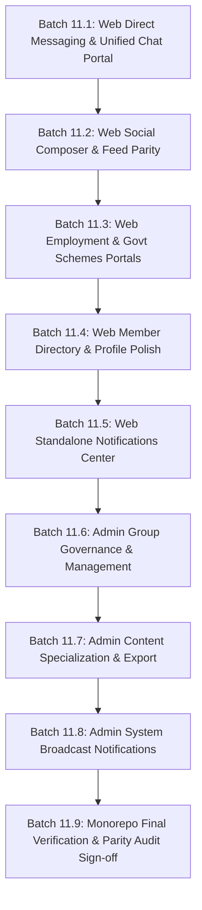

# Apna Samaj — Phase 11.0: Complete Mobile-to-Web & Admin Feature Parity Audit Report

**Audit Date:** November 18, 2026  
**Audited Baseline Commit:** [`2f36738`](https://github.com/ravindrakewat/ApnaSamaj/commit/2f36738) (`main` / `origin/main`)  
**Scope:** Forensic Codebase Audit comparing `apps/mobile` (Source of Truth), `apps/web` (Member Web Portal), `apps/admin` (Administrative Management Console), `apps/api` (Backend Engine), and Monorepo Shared Packages (`packages/*`).  
**Safety Status:** Read-Only Audit. Zero application source files modified. Zero migrations applied. Zero deployments triggered.

---

## 1. Executive Summary

Over the course of Batches 1 through 10.5, the **Apna Samaj Mobile Application** (`apps/mobile`) has achieved complete, end-to-end implementation of major platform features:
- Authentication & password recovery
- Rich social feed (with direct video upload, multi-photo posts, and WhatsApp-style YouTube previews)
- Full-featured real-time 1-on-1 direct messaging and community group chat (voice notes, attachments, emoji reactions, quoted replies, ephemeral deletions, media search, and gallery)
- Comprehensive matrimonial matchmaking and verification
- Dedicated Employment and Government Schemes discovery portals
- Centralized push notifications with granular preference controls

While the **Website** (`apps/web`) and **Admin Panel** (`apps/admin`) already feature substantial production implementations (including Vite React 18 SPAs, MUI v5 styling, JWT/refresh authentication, post viewing/appeals, member directory, matrimonial dashboard, and admin moderation queues), an audit reveals that **feature development on Mobile has outpaced Web and Admin in several critical user journeys**.

### Key Architectural Finding:
**The backend (`apps/api`) and database (`packages/database`) already support 95%+ of the required capabilities.** The REST endpoints, Prisma models, Socket.IO event handlers, and storage bucket proxies for direct chat, reactions, voice notes, attachments, appeals, matrimonial approval, and notifications are already implemented and tested.

**No database schema migrations or backend architectural rewrites are needed.** Parity can be achieved entirely through frontend component development and API client wiring in `apps/web` and `apps/admin`, maximizing code reuse.

---

## 2. Monorepo Architecture & Package Inventory

The repository is structured as an npm workspaces monorepo:

```text
├── apps/
│   ├── mobile/         # React Native + Expo SDK 52 (TypeScript, Hermes) — Source of Truth
│   ├── web/            # Member Web Portal (React 18 + Vite + MUI v5 + TypeScript)
│   ├── admin/          # Admin Management Console (React 18 + Vite + MUI v5 + TypeScript)
│   └── api/            # Multi-Tenant Core REST API & Socket.IO (Express + Prisma + TypeScript)
└── packages/
    ├── database/       # Prisma Schema & Scoped Multi-Tenant Connection Manager
    ├── shared-types/   # Universal DTOs, API Contracts, Enums, and Models
    ├── validation/     # Shared Zod Schemas for Form & API Request Validation
    ├── ui-config/      # Material UI Themes (Color palette, Typography, Elevation)
    └── i18n/           # Bilingual Localization Engine (Hindi + English JSON dictionaries)
```

### Monorepo Asset Inventory:
1. **`packages/database`**: Defines 32 Prisma models including `User`, `Profile`, `Group`, `Post`, `ChatMessage`, `DirectConversation`, `DirectMessage`, `ChatAttachment`, `ChatMessageReaction`, `MatrimonialProfile`, `PostAppeal`, and `AuditLog`.
2. **`packages/shared-types`**: Universal TypeScript definitions for Auth, Posts, Groups, Chat, Directory, Matrimonial, Notifications, Appeals, and Admin Metrics.
3. **`packages/validation`**: Universal Zod contracts for Phone, Auth, Posts, Video/Image constraints, Matrimonial, Groups, Chat, and Tenant validation.
4. **`packages/ui-config`**: Standardized theme tokens (`#1976D2` primary, `#9C27B0` secondary, `#F8FAFC` background).
5. **`packages/i18n`**: Pre-configured i18next dictionaries for `common`, `nav`, `auth`, `feed`, `directory`, `groups`, `matrimonial`, and `notifications` in both Hindi (`hi`) and English (`en`).

---

## 3. Mobile App – Implemented Source of Truth

The Mobile App (`apps/mobile`) represents the authoritative functional benchmark:

### 3.1 Authentication & Session
- **Login (`(auth)/login.tsx`)**: Phone input with fixed `+91` badge, password show/hide, active tenant badge (`kewat`), language toggle, duplicate-submission lock, 256-bit encryption trust footer.
- **Registration (`(auth)/register.tsx`)**: Full Name, Phone, Password, Gender chips (`MALE`, `FEMALE`, `OTHER`), expandable optional roots accordion (City, State, Sub-Caste, Gotra).
- **Forgot Password (`(auth)/forgot-password.tsx`)**: Phone + tenant slug, 60s cooldown timer, generic anti-enumeration protection.
- **Reset Password (`(auth)/reset-password.tsx`)**: Token entry/prefill, new & confirm password validation (>= 8 chars), automatic login redirect.
- **Session Security**: In-memory token retention, hardware Keystore / SecureStore persistence, automatic 401 refresh token rotation, atomic token purge on logout.

### 3.2 Social Platform (Feed & Posts)
- **Home Feed (`(app)/index.tsx`)**: Horizontal filter carousel with 8 categories (`All`, `General`, `Announcement`, `Event`, `Matrimonial`, `Business`, `Employment [रोजगार]`, `Govt Schemes [सरकारी योजना]`), keyword search, pull-to-refresh, infinite scroll.
- **Create Post (`(app)/post/create.tsx`)**: Title + Content validation, PostType picker, Group selection dropdown, multi-photo picker (up to 5 images with individual upload progress and deletion chips), direct video upload (up to 50MB with duration verification), YouTube link preview generator.
- **Post Card (`PostCard.tsx`)**: Author avatar, relative time localization, structured title, image grid/carousel, inline video player, WhatsApp-style YouTube preview card, optimistic like counter, comments sheet trigger, view tracking, mod pin/unpin badge, overflow report/delete sheet.
- **Post Details (`(app)/post/[id].tsx`)**: Deep-link route, comment composer with live character count, nested comments list, like/view counters, author profile link.

### 3.3 Members & Directory
- **Member Directory (`(app)/directory/index.tsx`)**: Search by full name, city, state, sub-caste, gotra. Filter BottomSheet with sub-caste chips, city filter, debounced search (400ms).
- **Member Profile Details (`(app)/directory/[id].tsx`)**: Avatar, verification badge, personal details, roots information, masked/unmasked phone privacy, direct message CTA button (`💬 व्यक्तिगत संदेश भेजें`).
- **My Profile (`(app)/profile/index.tsx`)**: Circular avatar with floating camera upload (5MB max), profile completion progress bar (with encouraging guidance), Bio, Personal Details, Roots Details, and Account Security cards.
- **Profile Settings (`(app)/profile/settings.tsx`)**: Hindi/English language cards, community switcher, 6 granular notification preference switches, destructive logout.

### 3.4 Community Groups
- **Group Discovery (`(app)/groups/index.tsx`)**: Public and Private segmented tabs, member count badge, join/leave actions.
- **Group Details (`(app)/group/[slug].tsx`)**: Cover image, description, privacy badge, join/leave action, member roster dialog, direct Group Chat navigation button.
- **Group Chat (`(app)/group/[slug]/chat.tsx`)**: Real-time Socket.IO chat, multimedia attachments, voice notes, emoji reactions, quoted replies, delete for everyone (within 1 hour for author, anytime for mod).

### 3.5 Real-Time Chat & Direct Messaging
- **Unified Chat Inbox (`(app)/chat/index.tsx`)**: Segmented tabs (`All`, `Personal`, `Groups`), unread count badges, delivery status ticks (`✓`, `✓✓`, `🕒`), last message preview.
- **1-on-1 Direct Chat (`(app)/chat/[id].tsx`)**: WhatsApp-style interface, presence dot, message bubbles, audio voice player with waveform, image/document preview, search inside conversation, media gallery drawer.

### 3.6 Matrimonial Platform
- **Discovery (`(app)/matrimonial/index.tsx`)**: Filter sheet (gender, age range, marital status, education, city), candidate cards with photo blur/lock for unapproved members, Send Interest button.
- **Profile Creation Wizard (`(app)/matrimonial/manage.tsx`)**: 7-step wizard (Personal Details, Education & Career, Family Structure, Lifestyle & Bio, Partner Preferences, Photo Gallery up to 5 photos, Review & Submit for Admin Approval).
- **Candidate Details (`(app)/matrimonial/[id].tsx`)**: Photo gallery carousel, 6 detail sections, Send/Accept/Decline Interest actions, Report & Block actions.

### 3.7 Employment & Government Schemes Portals
- **Employment Portal (`(app)/employment/index.tsx` & `[id].tsx`)**: Filter by city/type, search, salary/location pills, Recruiter profile card, direct Samaj Chat application bridge.
- **Government Schemes (`(app)/government-schemes/index.tsx` & `[id].tsx`)**: Category carousel, state filters, official website redirect with security warning, eligibility checklist, helpline tap-to-call.

### 3.8 Notifications
- **Inbox (`(app)/notifications/index.tsx`)**: All and Unread filter tabs, relative timestamps, 13 expressive emoji badges, optimistic read toggles, deep-link navigation to target posts/groups/profiles.
- **Push Notifications (FCM)**: Background message handler, foreground chat suppression, token rotation listener.

---

## 4. Website Feature Comparison

| Feature Module | Mobile Status | Website Status | Existing Web File | Existing Web API | Missing UI / Gaps |
|:---|:---:|:---:|:---|:---|:---|
| **Auth: Login** | COMPLETE | COMPLETE | [`apps/web/src/pages/LoginPage.tsx`](file:///c:/Users/HP/Downloads/dspromain/dspro58/apps/web/src/pages/LoginPage.tsx) | `auth.service.ts` (`/api/v1/auth/login`) | Minor: Lacks `+91` visual badge and tenant indicator chip. |
| **Auth: Registration** | COMPLETE | PARTIAL | [`apps/web/src/pages/RegisterPage.tsx`](file:///c:/Users/HP/Downloads/dspromain/dspro58/apps/web/src/pages/RegisterPage.tsx) | `auth.service.ts` (`/api/v1/auth/register`) | Missing: Optional Roots accordion (City, State, Sub-caste, Gotra) and Gender selection chips. |
| **Auth: Password Reset** | COMPLETE | COMPLETE | [`apps/web/src/pages/ForgotPasswordPage.tsx`](file:///c:/Users/HP/Downloads/dspromain/dspro58/apps/web/src/pages/ForgotPasswordPage.tsx), [`ResetPasswordPage.tsx`](file:///c:/Users/HP/Downloads/dspromain/dspro58/apps/web/src/pages/ResetPasswordPage.tsx) | `auth.service.ts` | 100% feature complete on Web. |
| **Social: Feed & Filters** | COMPLETE | PARTIAL | [`apps/web/src/pages/FeedPage.tsx`](file:///c:/Users/HP/Downloads/dspromain/dspro58/apps/web/src/pages/FeedPage.tsx) | `posts.service.ts` | Missing: Quick filter chips for `Employment [रोजगार]`, `Govt Schemes [सरकारी योजना]`, `Business`, and `Matrimonial`. |
| **Social: Create Post** | COMPLETE | PARTIAL | [`apps/web/src/components/CreatePostComposer.tsx`](file:///c:/Users/HP/Downloads/dspromain/dspro58/apps/web/src/components/CreatePostComposer.tsx) | `posts.service.ts` | Missing: Multi-photo upload grid (Web only supports 1 image or 1 video). Missing Group dropdown to post directly into a community group. |
| **Social: Post Card** | COMPLETE | COMPLETE | [`apps/web/src/components/PostCard.tsx`](file:///c:/Users/HP/Downloads/dspromain/dspro58/apps/web/src/components/PostCard.tsx) | `posts.service.ts` | Parity high: Supports video playback, YouTube embeds, likes, comments, and views. |
| **Social: Post Details** | COMPLETE | COMPLETE | [`apps/web/src/pages/PostDetailPage.tsx`](file:///c:/Users/HP/Downloads/dspromain/dspro58/apps/web/src/pages/PostDetailPage.tsx) | `posts.service.ts` | Deep linking, comments, WhatsApp sharing complete. |
| **Directory: Search & Filters** | COMPLETE | COMPLETE | [`apps/web/src/pages/DirectoryPage.tsx`](file:///c:/Users/HP/Downloads/dspromain/dspro58/apps/web/src/pages/DirectoryPage.tsx) | `directory.service.ts` | Complete: URL search sync, sub-caste dropdown, pagination. |
| **Directory: Member Profile** | COMPLETE | PARTIAL | [`apps/web/src/pages/MemberProfilePage.tsx`](file:///c:/Users/HP/Downloads/dspromain/dspro58/apps/web/src/pages/MemberProfilePage.tsx) | `users.service.ts` | Missing: Direct Message CTA button (`💬 Send Message`) to initiate chat with the member. |
| **Directory: My Profile** | COMPLETE | PARTIAL | [`apps/web/src/pages/ProfilePage.tsx`](file:///c:/Users/HP/Downloads/dspromain/dspro58/apps/web/src/pages/ProfilePage.tsx) | `users.service.ts` | Missing: Profile completion progress bar. Missing notification preferences section. |
| **Groups: Discovery & Detail** | COMPLETE | COMPLETE | [`apps/web/src/pages/GroupsPage.tsx`](file:///c:/Users/HP/Downloads/dspromain/dspro58/apps/web/src/pages/GroupsPage.tsx), [`GroupDetailPage.tsx`](file:///c:/Users/HP/Downloads/dspromain/dspro58/apps/web/src/pages/GroupDetailPage.tsx) | `groups.service.ts` | Complete: Public/Private tabs, join/leave, member roster. |
| **Groups: Group Chat** | COMPLETE | PARTIAL | [`apps/web/src/components/chat/GroupChatTab.tsx`](file:///c:/Users/HP/Downloads/dspromain/dspro58/apps/web/src/components/chat/GroupChatTab.tsx) | `chat.service.ts`, `chat.socket.ts` | Present inside GroupDetailPage. Missing: Attachment upload (images, docs, audio), message reactions, delete for everyone. |
| **Chat: Direct 1-on-1 Chat** | COMPLETE | **MISSING** | *None* | *None* (Backend has full API) | **Major Gap:** No `/chat` page, no inbox with direct message tabs, no 1-to-1 conversation view on Web. |
| **Matrimonial: Discovery & Detail** | COMPLETE | COMPLETE | [`apps/web/src/pages/MatrimonialDiscoveryPage.tsx`](file:///c:/Users/HP/Downloads/dspromain/dspro58/apps/web/src/pages/MatrimonialDiscoveryPage.tsx), [`MatrimonialProfileDetailPage.tsx`](file:///c:/Users/HP/Downloads/dspromain/dspro58/apps/web/src/pages/MatrimonialProfileDetailPage.tsx) | `matrimonial.service.ts` | Highly complete: filters, candidate details, photo gallery, interest buttons. |
| **Matrimonial: Dashboard & Edit** | COMPLETE | COMPLETE | [`apps/web/src/pages/MatrimonialDashboardPage.tsx`](file:///c:/Users/HP/Downloads/dspromain/dspro58/apps/web/src/pages/MatrimonialDashboardPage.tsx) | `matrimonial.service.ts` | 2076-line implementation with 8 tabs, photo uploads, document uploads, and interests. |
| **Employment Portal** | COMPLETE | **MISSING** | *None* | `posts.service.ts` (Parses `[रोजगार]` posts) | **Major Gap:** No dedicated `/employment` page, no JobCard component, no salary/type filters on Web. |
| **Government Schemes Portal** | COMPLETE | **MISSING** | *None* | `posts.service.ts` (Parses `[सरकारी योजना]` posts) | **Major Gap:** No dedicated `/government-schemes` page, no SchemeCard component, no eligibility checklist on Web. |
| **Notifications: Dropdown** | COMPLETE | COMPLETE | [`apps/web/src/components/NotificationBell.tsx`](file:///c:/Users/HP/Downloads/dspromain/dspro58/apps/web/src/components/NotificationBell.tsx) | `notifications.service.ts` | Highly complete 686-line component with popover, unread counts, mark all read, deep linking. |
| **Notifications: Standalone Page** | COMPLETE | **MISSING** | *None* | `notifications.service.ts` | Missing: Full-page `/notifications` inbox view (currently only popover). |
| **Notifications: Preferences** | COMPLETE | **MISSING** | *None* | Backend has API | Missing: 6 notification toggle switches in `/profile` or settings. |

---

## 5. Admin Panel Feature Comparison

The Admin Panel (`apps/admin`) is designed for platform governance and community moderation.

| Administrative Domain | Admin Requirement | Existing Admin Implementation | Status | Gap / Opportunity |
|:---|:---|:---|:---:|:---|
| **Dashboard & Metrics** | Overview of community health, member growth, post queues, appeal counts. | [`apps/admin/src/pages/DashboardPage.tsx`](file:///c:/Users/HP/Downloads/dspromain/dspro58/apps/admin/src/pages/DashboardPage.tsx) | COMPLETE | High quality: Key cards, quick actions, tenant switching. |
| **Member Management** | View roster, search, filter by role/status, toggle active/suspended, change roles, bulk import. | [`apps/admin/src/pages/MemberManagementPage.tsx`](file:///c:/Users/HP/Downloads/dspromain/dspro58/apps/admin/src/pages/MemberManagementPage.tsx), [`BulkImportDialog.tsx`](file:///c:/Users/HP/Downloads/dspromain/dspro58/apps/admin/src/components/BulkImportDialog.tsx) | COMPLETE | Missing: UI button for Member Directory CSV/Excel Export (backend and utility exist). |
| **Moderator Management** | Promote members to moderators, assign permissions, revoke roles. | [`apps/admin/src/pages/ModeratorManagementPage.tsx`](file:///c:/Users/HP/Downloads/dspromain/dspro58/apps/admin/src/pages/ModeratorManagementPage.tsx) | COMPLETE | Role-guarded for `SUPER_ADMIN` and `COMMUNITY_ADMIN`. |
| **Content Moderation** | Review reported/pending posts, approve, reject, flag, suspend author. | [`apps/admin/src/pages/ModerationQueuePage.tsx`](file:///c:/Users/HP/Downloads/dspromain/dspro58/apps/admin/src/pages/ModerationQueuePage.tsx), [`ModerationAnalyticsPage.tsx`](file:///c:/Users/HP/Downloads/dspromain/dspro58/apps/admin/src/pages/ModerationAnalyticsPage.tsx) | COMPLETE | Complete with decision analytics and audit logging. |
| **Member Appeals** | Review appeals against moderated posts, approve (restore) or reject. | [`apps/admin/src/pages/AppealsReviewPage.tsx`](file:///c:/Users/HP/Downloads/dspromain/dspro58/apps/admin/src/pages/AppealsReviewPage.tsx) | COMPLETE | Multi-role access (`MODERATOR`, `COMMUNITY_ADMIN`, `SUPER_ADMIN`). |
| **Matrimonial Moderation** | Review profile drafts, verify government IDs/documents, inspect photos, approve/reject/suspend. | [`apps/admin/src/pages/MatrimonialModerationPage.tsx`](file:///c:/Users/HP/Downloads/dspromain/dspro58/apps/admin/src/pages/MatrimonialModerationPage.tsx) | COMPLETE | 1288-line comprehensive review engine with document preview and report resolution. |
| **Audit Logs** | Immutable trace of all admin actions (bans, imports, approvals, role changes). | [`apps/admin/src/pages/AuditLogsPage.tsx`](file:///c:/Users/HP/Downloads/dspromain/dspro58/apps/admin/src/pages/AuditLogsPage.tsx) | COMPLETE | Paginated, filterable audit log viewer. |
| **Group Management** | View community groups, inspect member counts, transfer ownership, archive/delete groups. | *None* | **MISSING** | No `GroupManagementPage.tsx` exists. Admins cannot currently manage groups from the console. |
| **Employment / Scheme Moderation** | Specialized filters to review job listings and government schemes specifically. | Posts appear in generic ModerationQueue | PARTIAL | No filter chip or badge to distinguish job opportunities or schemes in moderation queues. |
| **Community / Tenant Management** | Dynamic tenant registration, viewing tenant database status, managing community metadata. | Hardcoded community switch dropdown (`kewat` vs `gupta`) in `AdminLayout.tsx` | PARTIAL | Missing dedicated Tenant Overview screen for Super Admins. |
| **Broadcast Notifications** | Send system-wide announcements or push alerts to all community members. | *None* | **MISSING** | No UI to dispatch a platform broadcast notification. |

---

## 6. Backend & Shared Architecture Verification

An inspection of `apps/api/src/modules/` confirms complete backend readiness:

1. **Direct Chat APIs (`apps/api/src/modules/chat/chat.routes.ts`)**:
   - `POST /api/v1/chat/direct` -> Start/fetch direct 1-to-1 conversation.
   - `GET /api/v1/chat/direct/inbox` -> Paginated user conversations with unread counts and last message.
   - `GET /api/v1/chat/direct/:conversationId/messages` -> Cursor-paginated message history.
   - `POST /api/v1/chat/direct/:conversationId/messages` -> Send direct message (with attachment, tempId, replyTo).
   - `POST /api/v1/chat/direct/:conversationId/attachments` -> Upload image/video/document attachment.
   - `POST /api/v1/chat/direct/:conversationId/messages/:messageId/reactions` -> Emoji reactions.
   - `DELETE /api/v1/chat/direct/:conversationId/messages/:messageId` -> Delete for Me vs Delete for Everyone.
   - `GET /api/v1/chat/search` & `GET /api/v1/chat/media` -> Message search & media gallery.
2. **Multi-Tenant Security Invariant**:
   All chat, post, and user endpoints enforce `resolveTenantContext` middleware. Client requests send `x-community-slug` header, binding the connection strictly to `req.db` via `assertDb(req.db)`.
3. **Socket.IO Real-Time Engine (`apps/api/src/modules/chat/chat.socket.ts`)**:
   Supports `chat:message:new`, `chat:message:reaction`, `chat:message:delete`, `chat:typing`, and `notification:new` events with origin authentication and tenant room multiplexing.
4. **Validation Contracts (`packages/validation`)**:
   Zod schemas `sendMessageSchema`, `toggleReactionSchema`, `deleteMessageSchema`, `createPostSchema`, and `upsertMatrimonialProfileSchema` are already exported in `@apnasamaj/validation`.

---

## 7. Feature Parity Matrix

### A. Mobile vs Website
| Feature Module | Mobile Status | Website Status | Parity Gap | Implementation Effort |
|:---|:---:|:---:|:---|:---:|
| 1. Direct 1-on-1 Messaging (`/chat`) | COMPLETE | MISSING | Critical | Medium |
| 2. Post Multi-Image Upload (up to 5) | COMPLETE | PARTIAL | Moderate | Low |
| 3. Feed Quick-Filter Carousel | COMPLETE | PARTIAL | Low | Low |
| 4. Employment Discovery & JobCard | COMPLETE | MISSING | High | Low-Medium |
| 5. Government Schemes Discovery & SchemeCard | COMPLETE | MISSING | High | Low-Medium |
| 6. Member Profile Direct Message Bridge | COMPLETE | MISSING | Moderate | Low |
| 7. Profile Completion Progress Bar | COMPLETE | MISSING | Low | Low |
| 8. Notification Preferences (6 Toggles) | COMPLETE | MISSING | Moderate | Low |
| 9. Full-Page Notifications Center | COMPLETE | MISSING | Low (Dropdown works) | Low |
| 10. Registration Roots Accordion & Genders | COMPLETE | PARTIAL | Low | Low |
| 11. Group Chat Attachments & Reactions | COMPLETE | PARTIAL | Moderate | Medium |

### B. Mobile vs Admin Management
| Management Domain | Admin Capability Required | Current Status | Parity Gap | Implementation Effort |
|:---|:---|:---:|:---|:---:|
| 1. Group Governance | Group list, member counts, ownership transfer, group archiving | MISSING | High | Medium |
| 2. Member Export | Export member list to CSV/Excel | PARTIAL (Import only) | Moderate | Low |
| 3. Post Category Filters | Filter posts in Moderation Queue by Employment / Scheme | PARTIAL | Low | Low |
| 4. System Broadcast Notifications | Send community-wide announcement to all members | MISSING | Moderate | Low-Medium |
| 5. Tenant Administration | Overview of community databases and status | PARTIAL (Switch only) | Low | Low-Medium |

---

## 8. Prioritized Implementation Roadmap

To systematically achieve complete feature parity without breaking existing working modules, the work is organized into **9 tightly scoped batches**:



### Batch 11.1: Web Direct Messaging & Unified Chat Portal
- **Objective:** Port Mobile's 1-on-1 direct messaging and unified inbox to the Website (`apps/web`).
- **Features:**
  - Dedicated `/chat` and `/chat/:conversationId` route.
  - Left-hand Conversation List with unread count badges, active tab filters (`All`, `Direct`, `Groups`).
  - Right-hand Chat Stream with real-time Socket.IO sync, delivery ticks, and auto-scroll.
  - Chat message composer with text, emoji reactions, and attachment upload integration.
- **Files Affected:** `apps/web/src/App.tsx`, `apps/web/src/components/Navbar.tsx`, `apps/web/src/pages/ChatPage.tsx` (new), `apps/web/src/services/chat.service.ts`.
- **Existing Assets to Reuse:** `apps/api/src/modules/chat`, `@apnasamaj/shared-types`, `apps/web/src/services/chat.socket.ts`.

### Batch 11.2: Web Social Composer & Feed Parity
- **Objective:** Upgrade `apps/web` social feed to match Mobile's rich post authoring and category filtering.
- **Features:**
  - Multi-image upload grid (up to 5 images with individual remove buttons) in `CreatePostComposer.tsx`.
  - Group selection dropdown in composer (allowing posting directly into member's groups).
  - Quick-filter category carousel in `FeedPage.tsx` (`All`, `General`, `Announcement`, `Event`, `Matrimonial`, `Business`, `Employment`, `Schemes`).
  - WhatsApp-style YouTube embed card styling parity in `PostCard.tsx`.
- **Files Affected:** `apps/web/src/components/CreatePostComposer.tsx`, `apps/web/src/pages/FeedPage.tsx`, `apps/web/src/components/PostCard.tsx`.

### Batch 11.3: Web Employment & Government Schemes Portals
- **Objective:** Introduce dedicated Employment and Government Schemes discovery and details pages on Web.
- **Features:**
  - Employment Discovery (`/employment`) with salary pills, type filter, location dropdown, and reusable `JobCard.tsx`.
  - Job Details (`/employment/:id`) with Recruiter profile card and direct Samaj Chat application CTA.
  - Government Schemes Discovery (`/government-schemes`) with category carousel, state filters, and reusable `SchemeCard.tsx`.
  - Scheme Details (`/government-schemes/:id`) with eligibility checklist, official website redirect with external security warning, and helpline tap-to-call.
  - Navigation links added to `Navbar.tsx`.
- **Files Affected:** `apps/web/src/App.tsx`, `apps/web/src/components/Navbar.tsx`, `apps/web/src/pages/EmploymentPage.tsx` (new), `apps/web/src/pages/EmploymentDetailPage.tsx` (new), `apps/web/src/pages/GovernmentSchemesPage.tsx` (new), `apps/web/src/pages/SchemeDetailPage.tsx` (new).

### Batch 11.4: Web Member Directory & Profile Polish
- **Objective:** Align Web Member Directory and User Profiles with Mobile feature set.
- **Features:**
  - Add Direct Message CTA button (`💬 व्यक्तिगत संदेश भेजें`) to `MemberProfilePage.tsx` (`/members/:id`) that routes directly to `/chat/:recipientId`.
  - Add visual Profile Completion Progress Bar with guidance cues to `ProfilePage.tsx` (`/profile`).
  - Add Notification Preferences management (6 toggle switches) to `ProfilePage.tsx`.
  - Add optional Roots accordion (City, State, Sub-caste, Gotra) and Gender chips to `RegisterPage.tsx`.
- **Files Affected:** `apps/web/src/pages/MemberProfilePage.tsx`, `apps/web/src/pages/ProfilePage.tsx`, `apps/web/src/pages/RegisterPage.tsx`.

### Batch 11.5: Web Standalone Notifications Center & Responsive Polish
- **Objective:** Create a full-page Notifications Center and polish responsive drawer navigation on mobile web browsers.
- **Features:**
  - Standalone `/notifications` page with `All` and `Unread` tabs, optimistic unread counter, and bulk mark-as-read.
  - Mobile hamburger drawer navigation in `Navbar.tsx` for clean view on smartphones and tablets.
- **Files Affected:** `apps/web/src/App.tsx`, `apps/web/src/pages/NotificationsPage.tsx` (new), `apps/web/src/components/Navbar.tsx`.

### Batch 11.6: Admin Group Governance & Management
- **Objective:** Add community group management to the Admin Console (`apps/admin`).
- **Features:**
  - `GroupManagementPage.tsx` (`/groups` in admin): Table of all community groups, member count, privacy badge, creator name, creation date.
  - Group details dialog with member roster inspection, transfer group admin ownership, and group archive/deletion controls with confirmation dialog.
  - Navigation item added to `AdminLayout.tsx`.
- **Files Affected:** `apps/admin/src/App.tsx`, `apps/admin/src/components/AdminLayout.tsx`, `apps/admin/src/pages/GroupManagementPage.tsx` (new), `apps/admin/src/services/admin.groups.service.ts` (new).

### Batch 11.7: Admin Content Specialization & Export
- **Objective:** Add member directory export and content category filters to Admin.
- **Features:**
  - CSV/Excel Member Roster Export button on `MemberManagementPage.tsx` using existing `csv-export.ts`.
  - Post Category filter dropdown in `ModerationQueuePage.tsx` to filter by Employment, Government Schemes, Matrimonial, and General posts.
  - Post view and engagement metrics inspection modal in admin.
- **Files Affected:** `apps/admin/src/pages/MemberManagementPage.tsx`, `apps/admin/src/pages/ModerationQueuePage.tsx`.

### Batch 11.8: Admin System Broadcast Notifications
- **Objective:** Enable Community Admins and Super Admins to send platform-wide announcements.
- **Features:**
  - `BroadcastNotificationDialog.tsx`: Compose title, message body, optional target link, and priority.
  - Backend integration to create notifications for all active community members and emit real-time Socket.IO / FCM alerts.
- **Files Affected:** `apps/admin/src/pages/DashboardPage.tsx`, `apps/admin/src/components/BroadcastNotificationDialog.tsx` (new).

### Batch 11.9: Monorepo Final Verification & Parity Audit Sign-off
- **Objective:** Comprehensive multi-platform end-to-end verification, typechecks across all 10 workspaces, build audits, and final documentation.

---

## 9. Security, Tenant Safety & Architecture Invariants

All parity implementations must strictly adhere to Apna Samaj's multi-tenant core rules:
1. **Explicit Tenant Context:** Every web fetch must supply `x-community-slug` via `getActiveCommunitySlug()`.
2. **Tenant Scoped DB Only:** All queries execute on tenant database bound to `req.db`. No fallback to default databases.
3. **Zero Secrets in Git:** No credentials or API keys in code or commit messages.
4. **Audit Only in Phase 11.0:** Zero code modifications made in this phase.
